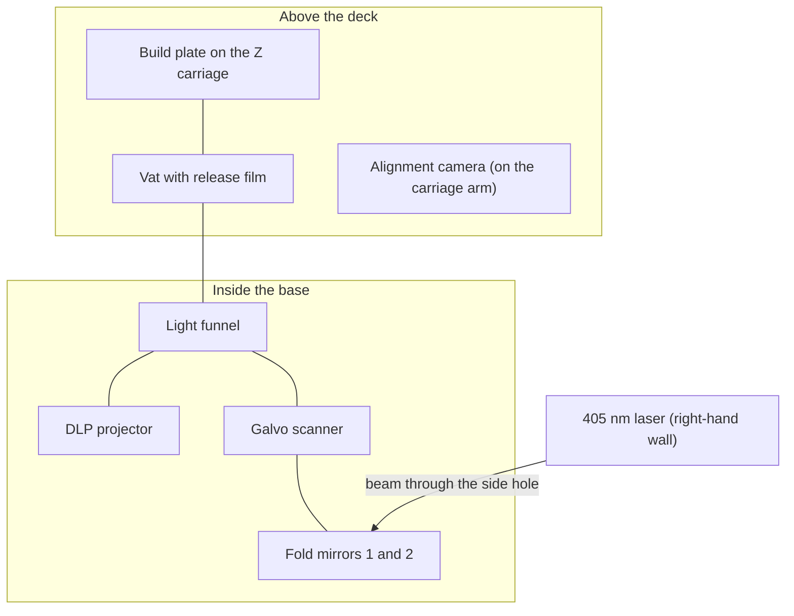

# Build guide

This guide describes how the HybridMASC prototype is put together: what to buy, what to print or machine, how the parts go into the chassis, how they are wired, and how to bring the machine up for the first time. Running the finished machine is covered by the [user manual](../manual/index.md); why each part behaves as it does is in the [design and implementation notes](../design-and-implementation.md).

!!! warning "This documents one prototype"
    HybridMASC exists as a single machine that is still changing. Several part models and dimensions aren't recorded yet. They are marked **to confirm** where they appear and collected on the [open items](open-items.md) page. The CAD files, the control board design files and the source code aren't in this repository yet, so the guide names them without linking to them.

## What you are building

HybridMASC is built into the chassis of a Formlabs Form 2. The Form 2's frame, Z tower, lead screw, fold mirrors and orange cover are kept. Its laser and galvo, resin tank, wiper and electronics are removed and replaced:

| Assembly | Where it sits | What it replaces |
|---|---|---|
| Vat with a release film, on a printed light funnel | On the top deck, over an opening cut for the funnel | The Form 2 resin tank and wiper |
| Build plate on a new arm, with the alignment camera | On the Form 2's Z carriage | The Form 2 build platform |
| DLP projector, pointing up | Inside the base, under the funnel | The Form 2 laser and galvo block |
| Galvo scanner and the Form 2's two fold mirrors | Inside the base, beside the projector | |
| 405 nm laser module and its driver | Outside, on the right-hand wall; the beam enters through a hole | |
| Controller, Z driver and power supplies | Front bay of the base and the right-hand wall | The Form 2 mainboard and display |
| Host laptop | Beside the machine | |

Both light sources reach the resin from below through the same film, so the projector cures a layer and the laser writes on it in one plane.

## The pages

1. [Parts list](parts.md): purchased parts, printed and machined parts, fasteners and consumables.
2. [Assembly](assembly.md): preparing the chassis and fitting each assembly.
3. [Wiring](wiring.md): the controller's pin map, power, and the cables to the host.
4. [First power-up](commissioning.md): firmware, host software, the first checks and the calibrations.
5. [Open items](open-items.md): what still has to be recorded before someone else can repeat the build.

## Skills and tools

- A fused-filament 3D printer with a bed of at least 200 × 145 mm (the largest printed part).
- Access to a mill, laser cutter or waterjet for the two vat seal plates (3.2 mm stock), or a service that makes them from the drawings.
- A way to cut the Form 2's sheet metal and plastic: the deck opening, the front bay and the laser entry hole.
- Soldering, crimping and a multimeter.
- Hex drivers for M3 hardware, and the Torx drivers a Form 2 teardown needs.
- A computer with the Arduino toolchain for flashing the controller.

## Safety while building

Read the manual's [Safety](../manual/safety.md) page first; it applies from the moment the laser is powered. A few points matter during the build in particular.

- **The laser is not enclosed until you make it so.** The beam runs in free space from the module, through the side wall, off two mirrors and into the scanner. While the base is open, and during mirror alignment, a misaimed mirror sends the beam out of the machine. Wear 405 nm laser eyewear, keep the power at the lowest setting that shows the spot, and block the beam path behind each mirror while you adjust it.
- **The orange cover is not a rated laser enclosure.** It dims violet light, but its optical density at 405 nm hasn't been measured. Don't rely on it in place of eyewear.
- **The laser's control input floats while the controller resets.** For a second or two during a reset or a firmware flash the laser can fire. Keep the laser supply off whenever you flash or reset the controller, or fit a pull-down resistor on the input (see [Wiring](wiring.md#laser)).
- **Mains wiring.** The power supplies have exposed terminals. Fit covers, earth the chassis, and have the mains side checked by someone qualified.
- **Until a film zero is set, nothing stops the plate at the vat.** Do the first Z moves with the vat removed.
- **Resin.** The machine is meant to run in a fume hood. Plan where it will stand before you build it: assembled, it is the size of a Form 2 with the laser and electronics adding about 80 mm on the right.
