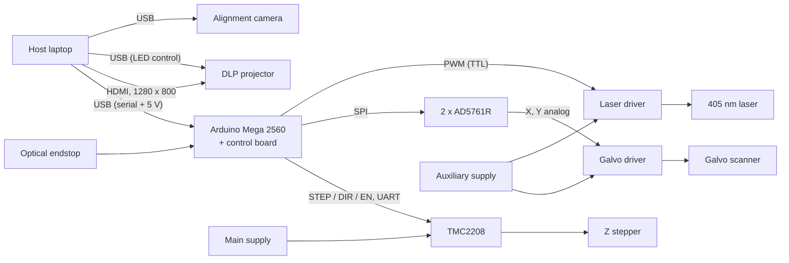

# Wiring

The controller is an Arduino Mega 2560 with a custom control board plugged onto it. The board carries the Z driver and the two galvo converters and breaks the signals out to connectors. Its schematic and layout will be published with the hardware files; until then, the pin map below is what the firmware expects, and any wiring that provides it will work.

## Controller pin map

| Function | Mega pin | Notes |
|---|---|---|
| Z STEP | D4 | |
| Z DIR | D3 | Positive is up |
| Z EN | D5 | Active low; the driver is disabled at power-up |
| TMC2208 UART | D16 (TX2), D17 (RX2) | Wire both directions, so the firmware can read the driver back |
| Z endstop | A7 | Read with the internal pull-up; HIGH when blocked |
| Galvo X DAC chip select | A9 | |
| Galvo Y DAC chip select | A10 | |
| DAC SPI | D51 (MOSI), D52 (SCK) | Hardware SPI, mode 2 |
| Laser modulation | D12 | PWM into the laser driver's TTL input |

## Z axis

- Connect the stepper's two coils to the TMC2208's motor outputs. If the plate moves down when commanded up, swap one coil's pair of wires.
- The driver's motor supply comes from the main power supply, not from USB. After the motor supply has been off, the driver forgets its settings; the firmware sends them again before every move.
- Microstepping (16) and current (600 mA RMS) are set by the firmware over the UART. They don't depend on the driver's jumpers or potentiometer, provided the UART works.
- Wire the endstop's supply, ground and signal. An unplugged sensor reads the same as a triggered one, and homing refuses to start in that state.

## Galvo

- Each AD5761R's output goes to one axis input on the galvo driver board, with a common signal ground.
- The firmware assumes a ±10 V output range and turns the converters' internal reference off, so the board must provide an external reference. How the prototype does this is **to confirm**.
- The scanner is used over a small part of that range. The starting window in the software is 0.5 to 6.5 V in X and 0.5 to 3.5 V in Y; calibration widens it to cover the projected field.
- The galvo driver board is powered from the auxiliary supply. Its supply voltages and the connector pin-out are **to confirm**.

!!! warning "Power order"
    The firmware sets up the converters once, when the Mega starts. If the galvo electronics are powered after the Mega, the scanner ignores every move until the Mega is reset. Since the Mega is powered from the host's USB, switch on the machine's supplies before the host.

## Laser

- Connect D12 and ground to the laser driver's TTL modulation input.
- The laser driver is powered from the auxiliary supply. Give it its own switch, so the laser can be made safe without shutting anything else down.
- **Fit a pull-down resistor** (10 kΩ is typical) from the TTL input to ground at the driver. While the Mega resets or is being flashed, D12 is undriven for a second or two; without a pull-down the input floats and the laser can fire. Whether the prototype's driver already has one is **to confirm**, so keep the laser supply off during any reset or flash.

## Power

| Supply | Feeds | Voltage |
|---|---|---|
| Main supply | Z driver (motor supply) | **To confirm** |
| Auxiliary supply | Galvo driver, laser driver | **To confirm** |
| Projector supply | DLP projector | As supplied with the projector |
| Host USB | Mega (5 V), camera | 5 V |

Give the Z motor, the galvo electronics, the projector and the laser separate switches, or at least a separate switch for the laser. Earth the chassis and both supplies' cases.

There is no emergency stop or sash interlock wired to the controller. The STOP button on the web page is software only. A hardware switch that cuts the laser supply is a sensible addition and is on the [open items](open-items.md) list.

## Host connections

| Cable | From | To | Purpose |
|---|---|---|---|
| USB | Host | Mega | Commands, at 500000 baud; also powers the Mega |
| HDMI | Host | Projector | Layer images at 1280 × 800, 60 Hz |
| USB | Host | Projector | LED on, off and level |
| USB | Host | Camera | Calibration pictures |

Plug the projector's HDMI straight into the host. The service drives that output directly, with no desktop session.
