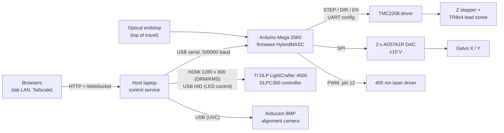

# HybridMASC: printer design and implementation

Reference notes for the manuscript, compiled on 2026-10-31. Everything here
comes from the source code and firmware in this repository, the firmware
flashed on the controller, and bench measurements made that day. Each value is
tagged with where it comes from:

- **measured**: measured on the machine on 2026-10-31 (method given in §8)
- **configured**: a setting in the firmware or software (file given)
- **inferred**: deduced from files or comments; confirm before publishing
- **TODO**: not recorded anywhere in the repository; fill in from the hardware,
  purchase records or lab notebooks (collected in §10)

Repository snapshot: branch `slicer`, firmware as of commit `fe3a1b1` (the build
flashed on the controller), web software as of `551debc`. The pre-2026-10-31
code is commit `05ff0d0` on `main`.

---

## 1. Concept

HybridMASC combines bottom-up digital light processing (DLP) vat
photopolymerisation with laser-driven metallisation. Each layer is first cured
by a projected image; on layers that carry conductive features, a 405 nm diode
laser steered by a two-axis galvanometer scanner then writes silver into the
cured layer by reducing silver trifluoroacetate (AgTFA) in the resin.
*(Chemistry: inferred from project notes; resin formulation is TODO.)*

Per-layer cycle (as implemented in the web service, §5.1 and §7):

1. **Move Z** to the next layer height
2. **Expose**: project the layer mask (longer "burn-in" exposure for the first layers)
3. **Laser Ag**: scan the silver pattern (silver layers only)
4. **Peel**: lift the build plate to release the layer from the vat film

The printer sits in a fume hood. A laptop beside it runs the control software and
serves the user interface to browsers on the lab network.

## 2. System architecture

The diagram shows the wiring as of 2026-11-01, with the projector connected
straight to the host. Before that the legacy desktop application (§5.2) sent
images to a Raspberry Pi display server over HTTP, and the Pi drove the projector
over HDMI (§3.3). The new web service (§5.1) drives the projector, the Z stage and the galvo,
and still simulates the laser (§9).

## 3. Hardware

### 3.1 Controller

| Item | Value | Source |
|---|---|---|
| Board | Arduino Mega 2560 R3 (ATmega2560, 16 MHz) | measured (USB ID 2341:0042) |
| Host link | USB CDC serial, 500000 baud since 2026-11-02 (115200 before; the service tries 500000, then 115200), line-based text protocol (§4.2) | configured, `firmware/HybridMASC/HybridMASC.ino` |
| Board identity | replies `"dev":"zmasc"` to `PING` | measured |

Pin map (configured, `firmware/HybridMASC/*.ino`):

| Function | Pin |
|---|---|
| Z STEP / DIR / EN (EN active low) | D4 / D3 / D5 |
| TMC2208 UART | Serial2: TX2 D16, RX2 D17 |
| Z endstop | A7, `INPUT_PULLUP` |
| Galvo X / Y DAC chip select | A9 / A10 |
| DAC SPI | hardware SPI (D51 MOSI, D52 SCK) |
| Laser modulation | D12 (PWM, Timer1) |

### 3.2 Z axis

| Item | Value | Source |
|---|---|---|
| Driver | Trinamic TMC2208, configured over UART at boot and again before every move from rest, homing run and enable (since 2026-11-02, see below) | configured, `z_driver.ino` |
| Driver UART | wired both ways: the driver's replies reach RX2, so its registers can be read back (`DRIVER?`) | measured (2026-11-02) |
| Motor | 200 full steps/rev (1.8°) | configured |
| Microstepping | 16 | configured |
| Lead screw | TR8x4 (4 mm lead), direct drive | configured (firmware comment) |
| Resolution | 800 microsteps/mm, i.e. 1.25 µm per microstep | derived |
| Motor current | 600 mA RMS | configured |
| Chopper mode | stealthChop (driver default; spreadCycle not enabled) | configured |
| Move speed | 10 mm/s firmware default; the web service sends its own with every move (Settings page, default 600 mm/min = 10 mm/s since 2026-11-02, before that 2 mm/s; the pages give all Z speeds in mm/min since 2026-11-03, and the service sends mm/s). Unloaded, 20 mm/s was the fastest speed without lost steps and 25 mm/s lost many (§8) | configured; limit measured |
| Acceleration | trapezoidal ramps since 2026-11-02: 20 mm/s² firmware default, the web service sends its Settings value (default 50 mm/s²). Moves start and arrive at 0.5 mm/s | configured, `z_stepper.ino`; profile measured (§8) |
| Endstop | optical slot sensor at the **top** of travel; output HIGH when blocked | measured |
| Direction | + is up | measured |
| Soft limit | absolute moves in mm are clamped to z ≥ 0 | configured, `z_units.ino` |
| Travel | hard stop about 205 mm below the top endstop | reported by the operator (2026-11-01) |
| Travel | at least 96 mm (distance from a parked position to the switch) | measured; full travel TODO |
| Motor model, linear guides, build plate | TODO | |

**Driver settings after a motor-power cycle** (2026-11-02). The TMC2208 is
powered from the motor supply, while the Mega runs from the host's USB. The
projector dropped off USB from 06:43 to 08:24 while the Mega stayed connected,
which suggests the machine's power was off for that time; that the motor supply
was switched with it is assumed, not confirmed. Afterwards
every Z move was twice as long as commanded, as reported by the operator: the
driver had come back with the microstep setting of its MS1/MS2 pins and the
current of its potentiometer, and the firmware had configured it only at boot.
Reflashing (which restarts the Mega and so reconfigures the driver) cured it.
The driver's write counter then read 18, the writes of the two restarts during
the flash, rather than the larger count it would have kept had it not lost power
since the morning's boot. The firmware now sends the settings again before
each move from rest, each homing run and each enable (about 45 ms each time).
After the fix, homing from the page's −22 mm took 13 s, which fits the real
travel of about 44 mm, and at −100 mm the camera saw the projected field at
236 x 347 pixels instead of the 369 x 590 seen at the same reading before.

Z coordinates: homing (§4.4) sets zero at the switch and parks 2 mm below it. For
printing, the operator jogs the build plate down to the vat film and sets zero
there (`ZERO`), so layer heights are measured from the film.

### 3.3 DLP projector

| Item | Value | Source |
|---|---|---|
| Make / model | TI DLP LightCrafter 4500 with the DLPC350 controller | measured: EDID monitor name "LCr 4500" (manufacturer DLP, product 0x4500); USB device 0451:6401 "DLPC350" |
| DMD | DLP4500, 912 x 1140 diamond-pixel array | inferred from the model (TI documentation for the LightCrafter 4500) |
| Video input | HDMI from the host at 1280 x 800, 60 Hz. The EDID also lists the DMD-native 912 x 1140 timing, which the host's graphics driver does not offer | measured |
| Light source | only the blue LED channel is enabled at power-up, under manual rather than sequencer control. Wavelength TODO | measured (USB status); wavelength TODO |
| LED current at power-up | red 255, green 255, blue 91, in the controller's 0–255 units, with PWM polarity normal | measured (USB) |
| LED current scale | reversed from TI's documentation: 0 is the brightest, and 240 and up give no light. Setting the controller's PWM polarity to inverted doesn't fix this cleanly (it stores 255 − v for a written v but reads back the stored number), so the polarity is kept normal and the web service shows 255 minus the controller's value (§5.1, §8) | measured (camera, USB), 2026-11-02 |
| Controller firmware | version fields read 0xFFFE (not a TI release number), so possibly a custom build | measured; meaning TODO |
| Pixel size at the build plane | 46.2 µm, equal in x and y to within the measurement (field 59.1 x 37.0 mm). Measured on a tissue screen in place of the vat film; not yet re-checked with a vat fitted. The slicer's default | measured (camera and a printed 10 mm scale bar, §8), 2026-11-02 |
| Irradiance at the build plane | TODO | |

**Control from the host** (`app/hmasc/projector.py`, since 2026-11-01). The host
runs no desktop session. The service opens the GPU first, which makes it DRM
master, finds the projector's connector by its EDID name, and scans out a
1280 x 800 XRGB8888 buffer on it. A new image therefore appears at the next
display refresh, with no window system or file reload in between. Light is
switched over USB with DLPC350 HID commands: LED enable (0x1A07) works as the
shutter, and current (0x0B01) sets the level. Switching the LED off avoids the
light that a black image still lets past the mirrors. The LED is switched off
when the projector connects, on STOP, when a job starts, after 5 minutes of
manual use, and whenever the service exits. The last of these matters because the
kernel's text console reappears on the projector as soon as the service releases
the output (console blanking is disabled on the host). The service account gets
access to the USB device through a udev rule (`app/deploy/60-hmasc-lightcrafter.rules`).

**Earlier configurations** (legacy application). Comments in
`core/projector_control.py` say that a LightCrafter was first driven with USB LED
control (`pycrafter4500`), and was later replaced by an HDMI-only projector behind
a Raspberry Pi. In that setup "LED off" was a black image, and brightness was
emulated by scaling pixel values. Whether the Pi-driven projector was a different
unit from the LightCrafter now connected is TODO.

**Display server** (Raspberry Pi, `projector/display_server.py`, legacy): a Flask
app on port 5000 shows images full-screen with `feh` (`-F -Z -Y --reload 0.1`).
A new image is copied over the file `feh` watches. Endpoints: `POST /display` (PNG
upload, optional auto-clear after *n* seconds), `POST /clear` (black image),
`GET /health`. It starts at boot from cron with screen blanking disabled.
Exposure start and stop therefore include an HTTP upload and up to 0.1 s of `feh`
reload latency. This latency hasn't been measured.

### 3.4 Laser and galvanometer scanner

| Item | Value | Source |
|---|---|---|
| Laser | 405 nm diode | project notes; model, maximum optical power and spot size TODO |
| Modulation | PWM on D12 into the driver's TTL input, 8-bit duty (0–255), Arduino default frequency for Timer1 (~490 Hz) | wiring and TTL input reported by the operator (2026-11-02); frequency configured, `galvo_laser.ino` |
| Power at boot | output off, stored duty 0 (since 2026-11-02; before, the stored duty was 255, so a bare `LASER on=1` fired at full power) | configured |
| Comms-loss watchdog | laser forced off 0.5 s after the last laser command (`L` or `LASER`); other traffic doesn't count (since 2026-11-02; before, 2 s after any serial line) | configured |
| Galvo DACs | 2 x Analog Devices AD5761R, 16-bit, SPI mode 2, 250 kHz (16 MHz / 64) | configured |
| DAC output range | bipolar ±10 V as assumed by the firmware; code = (V + 10) x 65535 / 20, i.e. 0.305 mV per LSB | configured; reference set-up to verify |
| Axis inversion | both axes inverted by default | configured |
| Usable voltage window | X 0.5–6.5 V, Y 0.5–3.5 V (legacy app limits) | configured, `user_settings.json` |
| Scanner model, scan optics, field size, mm per volt | TODO. The web UI's 10 mm/V and 60 mm field are placeholders | |

The laser first ran on its own Arduino (`firmware/LaserPWM`) and was later moved
onto the Mega. The flashed firmware is the merged version, confirmed by its reply
to `LASER?`. The laser driver's TTL input is wired to D12 (reported by the
operator, 2026-11-02); it worked with PWM under the legacy app. During a reset
or a flash the Mega leaves D12 undriven for a second or two, so the laser
supply should be off then unless the input has a pull-down. The
galvo drivers were connected to the DAC outputs on 2026-11-02 (reported by the
operator); the firmware accepts and reports galvo commands from the web service,
but the mirrors' response hasn't been observed yet. The DACs are configured
with their internal reference off, so they need an external one on the board. The
firmware configures them once, when the board starts: if the galvo electronics
are powered after that (as when the PC, and with it the board over USB, came up
first on 2026-11-03), the DACs ignore every move and the laser gives no light,
until the board restarts. Power the rest of the machine first, then the PC
(TODO: a firmware command to configure the DACs again, sent before each laser
run, would remove the dependence on the order).

Single galvo positions are sent as text commands (`GALVO`); laser paths go to
the firmware's path player (§4.3), which moves the galvo along straight segments
5000 times a second from a timer, so a line is drawn at an even speed whatever
the serial link is doing. Before it (2026-11-02), the service sent one `GALVO`
per point and waited for each reply: 81 points/s at 115200 baud, 67 in the
service (§8).

### 3.5 Alignment camera

| Item | Value | Source |
|---|---|---|
| Camera | Arducam 8MP USB, UVC (USB ID 0c45:6366) | measured |
| Modes | MJPEG up to 3264 x 2448 at 15 fps; 1600 x 1200 at 30 fps; 16:9 modes are centre crops of the 4:3 sensor | measured |
| Mounting | above the build area, looking down on the vat opening and projection optics | measured (image) |
| Settings | auto exposure (aperture priority), manual focus position 144 | measured (`v4l2-ctl`) |
| Use | galvo-to-projector alignment only | configured |

### 3.6 Host computer and network

| Item | Value |
|---|---|
| Host | HP 255 G7 laptop, AMD Ryzen 3 2200U (4 threads), 6 GB RAM |
| OS | Ubuntu 26.04.1 LTS, Linux 7.0 |
| Projector connection | direct from the host (HDMI and USB) since 2026-11-01; the legacy application used a Raspberry Pi (model TODO) on the lab LAN |
| Network | lab LAN over Wi-Fi (`wlo1`), also on a private Tailscale network. The firewall admits the web UI only from those two networks. The wired port `eno1` is usually unplugged and is marked `optional: true` in `/etc/netplan/00-installer-config.yaml` (2026-11-02), so `network-online.target` no longer waits its 2 min timeout for it at boot |

## 4. Firmware

Arduino sketch in `firmware/HybridMASC/` (main file plus tabs for comms, Z driver,
stepping, homing, units, galvo/laser, galvo path player). Built with arduino-cli
1.5.1, `arduino:avr` 1.8.8 (avr-gcc 7.3.0) and the TMC2208Stepper 0.2.5 library:
34.7 kB program memory (13 %), 3.7 kB RAM (44 %; the path player's queue is
0.9 kB). Flashing (or opening the port with HUPCL set) resets the board, which
loses its homing; the port needs `stty -F /dev/ttyACM0 -hupcl` again after a
flash, replug or reboot, or each service restart resets it too.

Steps come from a Timer5 compare interrupt. Since 2026-11-02 a second
interrupt on Timer3 runs the speed ramp 1000 times a second: it speeds up
toward the move's speed at the set acceleration, starts braking when the
distance left equals the braking distance, arrives at 0.5 mm/s, and on a
reversal (a new target behind the stage) brakes to a stop before turning round.
It can be interrupted by the step interrupt, so its float arithmetic never
delays a step.

### 4.1 Structure

`loop()` is cooperative: it advances the homing state machine, reads and executes
serial commands, and services the laser watchdog. Z step pulses are generated in
a **Timer5 compare-match interrupt** (CTC mode, 2 MHz tick, 0.5 µs resolution,
1 µs STEP pulse, direct port writes), so step timing doesn't depend on how long
the loop takes. Each interrupt emits at most one step toward the target position
(position mode) or in a fixed direction until the endstop triggers (seek mode,
used by homing). Before 2026-10-31 steps were emitted from `loop()` itself; §8
compares the two. The galvo path player (§4.3) runs from a **Timer4**
compare-match interrupt at 5 kHz, which lets the serial receive and Z step
interrupts cut in.

### 4.2 Command protocol

One command per line, `VERB key=value …`; one JSON reply line
(`{"ok":true,…}` or `{"ok":false,"err":…}`). Distances accept `mm`, `um` or raw
steps.

| Command | Purpose |
|---|---|
| `PING` | identify the board |
| `POSITION?` | position and target (steps and mm), homing state, homing error |
| `SETTINGS?`, `HOMING?` | motor and homing configuration |
| `ENDSTOP?` | endstop pin level and whether it counts as triggered |
| `GALVO?`, `LASER?` | galvo voltages, laser duty and state |
| `DRIVER?` | TMC2208 readback: whether its UART replies, writes counted since its last power-up, whether it has reset since it was last configured, microstep setting |
| `ENABLE on=1\|0` | motor driver enable |
| `MZ to=… \| by=… [vf=… va=…]` | absolute or relative Z move, optional speed |
| `GALVO x=… y=… [silent=1]` | set galvo voltages (±10 V); silent skips the reply (not safe for back-to-back streaming: the 64-byte receive buffer overflows) |
| `L pwm=0–255 \| on \| off [silent=1]`, `LASER on=1\|0` | laser duty and on/off |
| `PQ x,y,n,p …` | queue up to 8 path segments (§4.3): end point as DAC codes, ticks, laser duty; the reply gives `run`, `q`, `free`, `done`, `overruns` and `tick_us_max` |
| `PGO`, `PSTOP`, `P?` | play the queue, stop at once (laser off, queue cleared), state |
| `STOP`, `HALT` | `STOP` stops Z at once, `HALT` brakes it to a stop at the set acceleration; both abort homing and switch the laser off |
| `ZERO` | define the current position as z = 0 |
| `SET key=value …` | microsteps, current, speed, soft limits, endstop polarity, homing parameters, galvo inversion |
| `HOME`, `HOMEABORT` | start or abort homing |

### 4.3 Laser and galvo

`GALVO` writes both DACs immediately (SPI at 1 MHz since 2026-11-02, 250 kHz
before). `L pwm=n` sets the duty and turns the laser on (n = 0 turns it off).
Only laser commands (`L`, `LASER`, and the path player's `P` commands) feed the
laser watchdog.

**Path player** (`galvo_player.ino`, since 2026-11-02). A queue of 128 straight
segments, each an end point in DAC codes (0 = −10 V, 65535 = +10 V, as `GALVO`
maps volts, with the axis inversion applied in the firmware), a duration of
1–32767 ticks of 200 µs, and a laser duty for its length (0 for a jump). A
segment starts where the previous ended, the first where the galvo is. Each tick
moves 1/n of the way by whole DAC codes with the remainder carried (integer
DDA: no drift, the end point is hit exactly), writes both DACs and sets the
laser's PWM register directly. Playing stops by itself, laser off, when the
queue runs dry; the PC keeps it filled. While it plays, `GALVO` and anything
that would turn the laser on are refused, and a laser-off command stops it.

The service (`galvo.py`, `Galvo.play`) sends PQ lines of at most 60 bytes, one
at a time, so a whole line always fits the board's 64-byte receive buffer
however busy the player keeps it, and polls `P?` every 50 ms to refill the queue
and feed the watchdog. A laser line is cut into pieces of at most 10 projector
pixels (~0.46 mm), each end mapped to volts through the alignment, and each
piece timed from its length in mm, so the beam moves along the line on the
screen at the requested speed (`alignment.path_segments`). The edge trace demo
uses it.

### 4.4 Homing

Homing moves up to the top endstop in three bounded phases. The endstop is sampled
inside the step interrupt after every step.

1. **Seek**: up at 5 mm/s (ramped up from rest) until the switch triggers, then
   stops at once; fails after `home_max_mm`
   (215 mm by default, enough to reach the switch from the hard stop about
   205 mm below it).
2. **Back off**: down 2 mm, then in 1 mm steps while the switch still reads
   triggered; fails after 6 mm.
3. **Creep**: up at 0.5 mm/s to the switch; fails if not found within the distance
   backed off plus 2 mm.
4. Settle 50 ms, set z = 0 at the trigger point, park 2 mm below the switch.

Homing refuses to start if the switch already reads triggered, because an
unplugged sensor reads the same and backing off could drive the plate into the
vat. Failures are reported with a reason (`homing_error` in `POSITION?`).

### 4.5 Safety functions in firmware

- Motor driver disabled at power-up.
- Driver settings sent again before every move from rest, homing run and enable,
  so a motor-supply power cycle can't leave the driver in its pin defaults.
- Laser forced off 0.5 s after the last laser command, and by `STOP` and `HALT`;
  it starts with duty 0. The path player stops (laser off) on the same 0.5 s
  watchdog, on `STOP`, `HALT` and `PSTOP`, and when its queue runs dry.
- Homing limited in every phase (§4.4); `STOP` and `HALT` abort homing. `STOP`
  stops the motor at once, `HALT` brakes it.
- Galvo voltages clamped to ±10 V.

Known gaps are listed in §9.

## 5. Control software

### 5.1 Web service

`app/`: Python 3.14, FastAPI 0.150 on uvicorn 0.54. It runs as the systemd service
`hmasc` on port 80, and browsers open the host's address. The service is enabled
(`WantedBy=multi-user.target`), so it starts at boot without anyone logging in;
it runs as an unprivileged user with `NoNewPrivileges`. After the first
restart from the System page (2026-11-02) it came back by itself and reconnected
the projector, Z, galvo and laser. It started 2 min 13 s after boot, because the
unit waited for `network-online.target`, which on this host times out waiting
for the unplugged Ethernet port; the unit now only orders itself after
`network.target`. The Arduino kept running through the restart, so Z stayed
homed and the galvo kept its position. After that change and the netplan one
(§3.6), a shutdown and cold start brought the service up 12 s after boot. The
shutdown cut the Arduino's USB power, so it started fresh: Z unhomed, galvo at
0 V, laser off.

- **System page**: restarts the service (it exits and systemd restarts it), and
  since 2026-11-02 restarts or shuts down the computer. Both power actions first
  switch the laser off, darken the projector and brake Z, are refused while a job
  runs, and go through logind (`systemctl reboot` / `poweroff`), which respects
  shutdown inhibitors. The service account may do this without a password only
  with the polkit rule `app/deploy/60-hmasc-power.rules` installed.

- **State**: a single machine-state model (job, layer, phase, Z, galvo, laser,
  projector, calibration, events). It is pushed to every browser over a WebSocket
  10 times a second. Commands are REST calls.
- **Interface**: plain HTML/CSS/JavaScript with no framework, sized for
  gloved use. Tabs (2026-11-03), grouped by use: printing (Print, the dashboard
  with layer preview; Slicer, step 1 Slicing and step 2 Processing, laser lines and export;
  Jobs), hands-on (Machine, the Z, galvo, laser and projector by hand, called
  Manual before; Sequencer), setup and checks (Calibrate, galvo-to-projector
  alignment and projection measurement with the camera; Camera, live view and
  controls; Demo, edge trace), and on the right Logs, Docs, Settings (machine
  settings such as the Z move speed, each with its unit, range and default) and
  System. In a window of at least 1000 x 700 the header and tabs stay put: the
  pages laid out to fill the window (Calibrate, Camera, Demo, Slicer,
  Sequencer, Logs, Docs) scroll only inside their cards, and the others scroll
  as a whole below the tabs when they don't fit (before 2026-11-03 they were cut
  off: at 1500 x 850 the bottom of the Machine tab couldn't be reached). In a
  smaller window, or zoomed in past that, the whole page scrolls instead.
- **Interaction rules**: STOP is always one tap with no confirmation. The laser
  must be armed, then fired with press-and-hold. While the button is held the
  browser repeats the request every 300 ms, and the service turns the beam off
  after 1 s without one. Values are shown in physical units (mm, mm/s, mW, s), not
  volts or PWM counts, except where the hardware isn't calibrated yet: galvo
  positions in volts, laser power as PWM duty, and projector LED current, which is shown
  as a 0–255 level until it is calibrated: 255 is the brightest and 0–16 give no
  light, the reverse of the controller's own value (§3.3). The level is typed, or
  stepped by 5 (a slider until 2026-11-03, too coarse for a set value). A manually switched-on
  projector LED goes off by itself after 5 minutes. **Expose for** (Machine tab,
  2026-11-03) switches the LED on with the image that's showing for a set time
  (0.1–300 s), timed by the service, and off again; the log gives the time it was
  actually on. It refuses while the image is black. While it runs, everything
  else that would change the machine is refused, except LED off, which ends it
  early, and STOP.
- **Camera**: the camera's own MJPEG frames are passed through without re-encoding
  at 1600 x 1200, capped at 8 fps per viewer. Since 2026-11-02 the camera runs
  all the time the service does (and starts again when plugged back in): it costs
  ~3 % of one core, and the picture then appears at once, already exposed. Pages
  only pull the stream while the Camera or Calibrate page is on screen.
  Calibrate shows just the view; the Camera page (since 2026-11-02) has the view
  with zoom, crosshair and snapshot, and beside it the camera's own controls,
  greyed out while an alignment run is using the camera: exposure, focus and white
  balance (each auto or manual), gain, and under "Image adjustments" brightness,
  contrast, saturation, sharpness, gamma, anti-flicker and a reset to the camera's
  defaults. Values set there are saved (`app/data/machine.json`) and applied again
  whenever the stream starts, since the camera forgets them when unplugged and its
  default focus is far out. The camera refuses a manual exposure time, focus or
  colour temperature while that control's auto switch is on, so those are skipped
  until it is off. Switching one to manual resends its setting (and, for
  exposure, the gain) a few times over about 4.6 s, because the camera keeps
  what auto chose and ignores writes for a while after the switch (§8). Exposures
  longer than one frame show the frame rate they leave. The view zooms 2–8x (a click zooms in on, or recentres at, that
  point), can show a centre crosshair, and Snapshot downloads the current frame as
  the camera's own JPEG.
- **Hardware**: the projector is real when connected (§3.3). It powers up with
  its LED on (about 40 s after the computer boots, its USB control appears and
  the service switches the LED off). Its start-up then goes on: about 5 s later it
  switched the LED back on by itself (2026-11-03). Since then the service reads
  the LED state back every second and, as only it switches the LED on, switches
  it off again when the projector has turned it on (logged, at most once a
  minute); an LED found off when it should be on is left off. The same check sets
  the LED PWM polarity back to normal if the projector has reset it. The Machine tab (called Manual until 2026-11-02) shows
  test images (black, white, a 16 x 10 grid with a centre square and a corner
  marker that shows mirroring, and a focus target with Siemens stars at the centre
  and corners plus 2–8 px bar groups) and switches the LED.
- **Z stage** (`hmasc/zstage.py`, since 2026-11-01): the service finds the Mega by
  its USB ID, checks that it answers `PING` as `zmasc`, and polls `POSITION?` ten
  times a second. The port is opened without HUPCL, so reopening it doesn't reset
  the board and lose its homing. A reply that parses but lacks a key (a byte
  garbled on the wire) is logged and asked for again once; a second one is a lost
  link, and the service reconnects. A bad `GALVO?` reply is logged and skipped.
  This was added on 2026-11-04, when a `POSITION?` reply without `homing_state`
  stopped the poll loop sometime overnight without a log line. The page kept
  showing the last values as live, the Mega's RX/TX LEDs went dark, and every jog
  returned an internal error. Each background loop (page updates, watchdog,
  projector, Z and galvo, camera) now runs under `keep_alive` in `main.py`. If one
  dies, that goes to the event log, and the loop starts again after 2 s. Moves from the Machine tab are refused until the
  stage is homed. They run at the move speed and acceleration set on the Settings
  page (defaults 600 mm/min and 50 mm/s²; 6–1200 mm/min and 1–200 mm/s², with
  warnings from 900 mm/min, close to the measured limit, and above 100 mm/s², the
  fastest acceleration tested, §8). Z speeds are in mm/min on every page (Settings,
  Peel card, Sequencer), as resin slicers give them, since 2026-11-03; the move
  speed was saved in mm/s before and is carried over at service start
  (`settings.migrate`). Acceleration stays in mm/s², and galvo and laser speeds
  in mm/s. Moves are sent as absolute step targets that
  the service has checked against its own limits; the firmware clamps only targets
  given in mm. The film zero ("Set film zero") is stored by the service as an
  offset from the endstop (`app/data/machine.json`), so it survives re-homing and
  restarts. Since 2026-11-03 it can also be typed in on the Settings page (Z
  motor, "Film zero", as mm below the top switch, 0.5–215; empty and Save clears
  it), so a known depth needn't be found again by jogging; the service refuses a
  depth above where the plate is now. Once it is set the stage won't go below it; before that there is no
  software floor, and travel down ends at the frame's hard stop. Page moves stay
  0.5 mm below the endstop. The STOP button stops the motor at once; the Halt
  button, and the service when it shuts down, brake it to a stop. Demo jobs are refused while the real stage is connected.
- **Galvo** (`hmasc/galvo.py`, since 2026-11-02): commands go to the same Mega
  over the Z stage's serial link. Positions are DAC volts, because the scan optics
  aren't calibrated in mm. The Machine tab jogs in 0.01, 0.1 or 1 V steps, and
  moves to typed coordinates or to a point clicked on the field view. Every
  target must lie inside an allowed range that the operator can edit; it is stored
  in `app/data/machine.json`, and the default (X 0.5–6.5 V, Y 0.5–3.5 V) is the
  legacy app's. The service reads `GALVO?` once a second. Nothing can read the
  DACs or the mirrors back, so the page shows the last commanded position. A board
  reset returns both axes to 0 V, which is outside the default range.
- **Laser** (`hmasc/galvo.py` and `hmasc/sim.py`, since 2026-11-02): real when the
  board is connected. Power is set as PWM duty in percent, up to a limit the
  operator sets (saved in `app/data/machine.json`); it isn't calibrated in mW.
  Arming and firing are refused while the galvo is outside its allowed range.
  Firing sends `L pwm=<duty>` and the service resends it every 200 ms while the
  button is held, which also applies a power change. The beam goes off on
  release, 1 s after the browser's last hold request, on disarm, on STOP, and
  when the service exits; the firmware also cuts it 0.5 s after the last laser
  command, so a stalled service can't leave it on. If the board reports the laser
  on without the service having fired it, the service switches it off and logs
  an error. Prints play each layer's laser lines through the path player (§7).
- **Galvo-to-projector alignment** (`hmasc/alignment.py`, Calibrate page, since
  2026-11-02). With the laser armed and Z homed, a run moves the camera to
  200 mm below the top endstop (never below a film zero), puts the camera on a
  checked manual exposure (§8), projects a lattice of 77 dots (radius 14 px) at
  the lowest LED level that shows them, and three single dots to find which way
  round the camera sees the projector. The dots fit a camera-to-projector model
  (quadratic, or cubic when that is clearly better). With the projector dark, the
  laser then fires at 1 % (settable) for about half a second at each point of a
  grid. Since 2026-11-02 19:30 the grid is even on the projected field, 2.5 %
  inside its edges (5 % until 19:45, which left the edge trace 30-55 px outside
  the measured points), with the rows set on the page (5 by default) and as many columns as
  keep the spacing about equal both ways (7 x 5 = 35 points, ~8.6 mm apart); the
  last alignment turns each point into volts, and points outside the galvo's
  allowed range are skipped. Before, and still on a first run (or when fewer than
  9 points fall inside the range), it is an n x n grid even in galvo voltage,
  inset 5 % from the allowed range: on the screen that grid is a keystone
  trapezoid (top edge 55.2 mm, bottom 59.3 mm, corner angles 85.7-94.6 degrees
  on the 19:26 run), and its wide edge reached past the projected field into the
  glare at the screen's edge. Each spot is found after removing the sensor's row
  smear, inside the projected field and (for a grid on the field) within 25
  camera px of where it should be, as the centre of its bright core, in the
  mean of ten frames. Each shot's picture around its spot is kept with the raw
  pictures (`shots`, 240 x 240 px). The galvo model is cubic when that predicts
  left-out points at least 10 % better (from 20 points), quadratic otherwise. Quadratic models
  from volts to projector pixels and back are fitted after dropping gross
  misdetections (worst point over 3 px and four times the median, up to a fifth
  of the points); fitting without each point in turn gives the expected error.
  The result (models, points, errors, mm per volt and axis angles) is saved in
  `app/data/machine.json`, with an annotated camera picture
  (`app/data/alignment.jpg`) and the raw pictures. The page plots it in
  projector pixels: the galvo range through the model, the grid's targets (or,
  for a volts grid, the measured voltages through the model), each spot, and its
  residual magnified. Everything (laser, projector, camera
  settings, galvo, Z) is put back afterwards, and STOP or Abort ends a run.
- **Measure projection** (Calibrate page, since 2026-11-02). With the room lit
  and Z homed, the camera moves to 200 mm below the switch with its focus fixed,
  takes a picture of the printed 10 mm scale bar on the screen with its own
  exposure, then maps camera to projector pixels with the dot lattice as the
  alignment does. The bar is found as 11 evenly spaced dark tick lines (every
  tick darker than every gap; spacing checked to be even). Ticks are picked out
  against a blur along the bar only: a 2D blur let the solid black block beside
  the lower ticks fill the gaps between them, and the bar went unfound. If it
  isn't found or
  looks wrong, its two ends can be clicked on the picture. Both ends are mapped
  into projector pixels, so the camera's own distortion cancels: 10 mm over that
  distance gives the pixel size and so the field in mm. The last alignment's
  pixels-to-volts model, followed around the field's edge, gives the galvo range
  that covers the whole field (plus 1 %), with a note when it reaches beyond the
  voltages that alignment measured. "Use this pixel size" sets the projector
  pixel size setting (Settings page; the slicer's default and the alignment's mm
  scale), and "Use this galvo range" sets the galvo's allowed range.
  The bar search takes about 7 s and runs in a worker thread: on the service's
  event loop it held up the Z controller's 1 s poll, which took the board for
  lost and then skipped moving Z back.
- **Live run view** (Calibrate page, since 2026-11-02). Each alignment or
  measurement keeps a record for the page (`AlignmentRun.live`, served at
  `/api/calibrate/live`; the state only carries its version, `alignment.live_v`):
  a timeline of its steps with times and what each found, and what it has found
  so far in camera pixels. The page draws that over the camera view as it
  arrives: the orientation dots, the dot lattice, the projector field and its
  lattice lines warped onto the camera, the scale bar, a reticle where the last
  alignment says the laser will land, each laser spot as it is found, then the
  fitted galvo grid and every point's residual (x20). Once the field is mapped
  the view zooms to frame it (no animation: things simply appear), with the run's numbers along the bottom and a
  LASER marker while the beam is on. Afterwards the overlay stays over the live
  view while the camera is at the height the run measured from (it only lines up
  there), and is rebuilt from the saved alignment after a restart.
- **Projector preview** (Jobs tab, since 2026-11-03; `hmasc/jobpreview.py`,
  `POST /api/jobs/{id}/project`). A job card's Preview button opens a popup that
  plays the job's layers on the projector in turn, from a chosen layer, at 0.25, 0.5 or 1 s a layer or
  at the job's own exposure times (burn-in layers longer), at a chosen LED
  level (default 48; the level before is put back afterwards). Z, the galvo
  and the laser are left alone. The LED stays on from layer to layer and goes
  off at the end, on Stop or STOP, or on an error. The popup shows an estimate
  of the time beforehand, then the layer on the projector and its number;
  closed, it leaves the preview running and the card's button shows the layer.
  It is for an empty vat or none: the light cures resin, and with Z still every
  layer would cure in the same place, so Start needs a "the vat is empty or
  out" box ticked each time the popup opens. Tested
  2026-11-03 on the 3DBenchy (480 layers): layers 470-480 at 0.25 s took
  3.0 s, Z stayed put, and Stop part way switched the LED off.
- **Clean vat** (Print tab, since 2026-11-03; `hmasc/vatclean.py`, `POST
  /api/vat/clean`), as consumer resin printers' "tank clean": a popup sets the
  cure time (default 15 s, 1-120) and LED level (default 255) and needs a "the
  plate is up or off, and there's resin in the vat" box ticked. The plate goes up
  to the top limit first (Z must be homed; it must never come down onto a failed
  print stuck to the film, and the sheet mustn't stick to it), then the whole
  field shows white for that time, curing one thin sheet that catches loose bits
  and failed layers; it's peeled off the film by hand. Stop or STOP switches the
  LED off at once, and the LED level goes back afterwards. Tested against a
  simulated machine only (a real run cures resin).
- **Sequencer tab** (since 2026-11-02; `hmasc/sequence.py`). Short machine
  programs, built from steps: Z move (to a height, or up or down by a positive
  distance, at its own speed of 6-1200 mm/min, starting at the Settings page's
  move speed; saved as `speed_mm_min`, and older steps' `speed` in mm/s is
  converted; the same limits as the Machine tab), Home Z, Wait, Project (black,
  white, grid or focus image at an LED level for a time, or kept on while the
  next steps run), Projector off and Laser line (points, power, speed, through
  the galvo path player); and, from a
  sliced job chosen at the top of the tab (the Slicer's current slice or a saved
  job), Project layer (that layer's mask, timed or kept on) and Laser layer (that
  layer's laser lines, each at its own power and speed, through the job's pixel
  size and mirroring so they land on its mask, as in the Processing step's preview;
  shared code in `alignment.job_line_segments`). The field view then shows the
  selected layer's mask and lines; new layer steps start on the first layer that
  has laser lines. A Repeat step runs the steps from a chosen earlier one up to it a
  number of times in all, or until stopped; repeats nest (an inner one starts
  afresh each outer pass), the page indents the steps inside and draws a band
  marked with the count over them, and keeps the target on the same step when
  steps are added, moved or deleted. With "+1 each pass" a layer step takes the
  next layer each time it runs, so a repeat can cycle through a job's layers
  (past the last layer stops the run with a message). A Print job step
  (2026-11-04) prints a saved job, chosen on the step, exactly as Start print on
  the Jobs tab does. The service runs it as the print, so the Dashboard's Pause,
  Resume and Stop print work on it, and the sequence waits for it to finish. A
  print leaves the plate at the top. Each print is checked as it starts (homed,
  film zero, projector, lifts); a job with laser lines needs the laser armed
  before the sequence starts. The sequence's Stop ends the print as Stop print
  does, with the plate going up. STOP stops both where they are. A print that
  fails, or that Stop print ends, ends the sequence with that reason. The step's
  estimate is the job's print estimate. A Pause step (2026-11-04) waits until
  someone presses Continue. A prompt with the step's optional message (up to 200
  characters) shows over whichever tab is open, at the top of the page. It's a
  non-modal dialog, so the header's STOP stays clickable. The prompt also has
  Stop sequence (`POST /api/sequence/continue`; the run's `alignment.prompt` is
  the message while it waits). A projector LED kept on by an earlier step stays
  on while it waits. The estimate leaves pauses out and says "+ pauses". Steps
  can be dragged to a new place by their number (2026-11-04), as well as moved
  with the arrows; repeats keep pointing at the same steps either way. The
  estimate follows the repeats. Laser line
  points are mm from the projected field's centre in the projector's
  own frame, turned into projector pixels with the pixel size setting and into
  volts through the alignment. The page shows the steps as a strip of blocks as
  long as their estimated times and as editable cards, and draws the laser
  steps on the field. Since 2026-11-04 the field is drawn on as in the Processing
  step. Clicks add points to a new line. A double-click, Enter or a click on the
  last point finishes it as a Laser line step, placed after the selected step at
  the power and speed of the selected or last laser line. Escape drops it, and a
  click on a line selects its step. Behind the field is the job chosen at the top,
  as the projector shows it: a layer picked under the field (or the selected layer
  step's, or the running one's), the part's exact outline on that layer
  (`/api/jobs/{id}/outline/{n}`), and the job's own laser lines. The outline and
  the lines are converted from the job's build-plane mm to the field's projector
  frame through the job's pixel size and mirroring. Points snap to the part's
  corners, the points of other lines and a 0.1, 0.5 or 1 mm grid (or none). Shift
  keeps a segment straight, the wheel zooms about the pointer, right-drag pans, and
  Fit frames the part. The field also shows where the laser dot is. It takes the galvo's last commanded
  volts from the state, runs them through the saved alignment's `galvo_to_proj`
  model (the page evaluates the same `Poly2`), and reloads that model when a new
  alignment is saved. A ring marks where the beam would land, and it fills violet
  while the laser fires. The board can't report where the galvo is while a path
  plays (`GALVO?` still gives the path's start), so `Galvo.play` works it out
  instead. The player's `done` count of finished segments is never reset, so the
  galvo is on segment `done − done0`. The time since that segment began gives how
  far along it is. A line's pieces are about 0.46 mm long. Tested offline against a
  fake board on its own clock: median 7 mV off and 12 mV at worst, about 0.06 mm.
  While a path plays, the galvo poll leaves that position alone. The whole-sequence Repeat box at the top was removed on 2026-11-04, since a Repeat step at the end does the same. A draft or saved sequence that used it gets that step when it's opened, and the service still accepts `repeat` (default 1). A sequence can be saved by name
  (`machine.json`, `sequences`); the page keeps the one being edited in the
  browser. The service runs it (`POST /api/sequence/run`), checking each step
  first, showing the current step, and ending with the laser and LED off; STOP
  or Stop ends it. Laser steps need the laser armed. Tested 2026-11-02: an
  8-step sequence (wait, grid kept on, a 20 mm line at 50 mm/s, a 0.3 s spot,
  projector off, Z down and up 0.5 mm, galvo move) ran in 2 s. Since 2026-11-03
  there are no Laser spot or Galvo steps (a short Laser line does for a spot),
  and Z moves are to / up / down with a speed each (saved as mode, mm, speed;
  older "relative" moves are read as up or down, and the page drops spot and
  galvo steps from an older draft). Tested 2026-11-03: down 1 mm at 2 mm/s
  then up 1 mm at 5 mm/s took 0.69 s and 0.48 s and came back to the start.
- **Demo page** (since 2026-11-02): the edge trace below, with the same camera
  view, overlay and timeline as Calibrate.
  - *Check on new points* (`/api/calibrate/verify`, saved as `alignment_check`;
    on the Demo page at first, now only through the API)
    runs like the alignment (camera to its height, fresh dot-lattice camera
    mapping, laser test shot), then fires at n projector pixels the alignment
    never measured, one at a random place in each cell of a grid kept 8 % inside
    the field, through its pixels-to-volts model, and measures each miss in
    projector pixels and µm. The misses are drawn x20 from each target, green
    under 150 µm, amber under 300, red above.
  - *Trace the edge* (`/api/calibrate/trace`) lights a thin outline 8 px inside
    the projected field and runs the laser round it through the alignment's
    pixels-to-volts model, one galvo point per serial command, resending the
    laser level every 0.2 s for the firmware's 0.5 s watchdog. The board takes
    about 67 moves a second (one round trip each), so points are 24 projector
    px (1.1 mm) apart and a round takes about 2.6 s; smooth or faster drawing
    would need the firmware to play a list of points itself.
  - A *click to aim* demo (crosshair at a clicked point, laser fired into it)
    was tried and removed: it read 470-730 µm misses near the centre where the
    check read 60-220 µm at the same voltages, unexplained (galvo hysteresis
    ruled out: four approach directions landed within 1.5 camera px).

### 5.2 Legacy desktop application

`main.py`, `core/`, `ui/` (PySide6/Qt). It finds the boards by sending `PING` to
every serial port and drives the Z stage, galvo, laser (with a 750 ms keep-alive)
and projector (through the Pi server).

- **Print routine** (`core/print_runner.py`): the operator zeroes Z at the vat
  film. For each layer it shows a fixed image (`D638.png`), with a longer exposure
  for the first burn-in layers. It then blanks the projector, lifts by the peel
  distance and descends to the next layer height. It finishes with a 50 mm retract.
  The UI defaults are 50 µm layers, 5 burn-in layers at 30 s, 8 s normal exposure,
  5 mm lift and 10 mm/s.
- **Laser writing** is separate from the print routine. Pattern runners (3 x 3
  grid, square, circle) step the galvo through voltage space on a timer (default
  0.25 V every 150 ms). A PWM sweep steps laser duty for dose series.
- Its Slicer tab was a placeholder: it could load and display a PNG but did not slice.

## 6. Slicing and job format

`app/hmasc/slicer.py`, used from the web UI's Slicer tab (its steps 1, Slicing, and 2, Processing).

**Inputs**: a part STL (binary or ASCII, millimetres). The slicer can also take a
silver STL marking the conductive regions (below), but since 2026-11-02 the
Slicer page doesn't offer it: the first prints are simple DLP-only shapes.

**Simple shapes** (since 2026-11-02): instead of a file, the page can make a box
(width, depth, height), cylinder (diameter, height), tube (outer and inner
diameter, height), cone (base and top diameter, height; top 0 for a point) or
sphere (diameter). It builds a closed binary STL in the browser, standing on
z = 0, and loads it exactly like a chosen file. Round shapes get enough sides
(48 to 400) that each flat facet strays at most ~5 µm from the true circle, a
tenth of a projector pixel. All five sliced without open-edge warnings at their
default sizes.

**Orientation** (since 2026-11-02): the page shows the part in 3D (three.js
0.160.0, vendored in `static/vendor/`, parsed from the chosen file in the
browser) on the build plate, with the projector field drawn to scale. Hovering
lights up a flat face (coplanar triangles grouped by normal and plane, to
0.005 and 0.02 mm); clicking one turns the part by the smallest rotation that
points that face's normal straight down. The page sends that rotation (a 3 x 3
matrix) with the slice request and the service turns the mesh by it before
slicing, so the slice matches what was shown; it is recorded in the manifest
(`rotation`). A face under 1 mm² gets a warning that the part would stand on an
edge or a point.

**LED level** (since 2026-11-03): the Slicing step sets the projector LED level
for every layer (16–255 on the page's scale, 255 the brightest, below 16 no light;
default 150 since later on 2026-11-03, 164 at first, the level the projector
starts up at by itself). It is saved with
the job (`settings.led_level`) and shown in the slice summary and on the job card,
because the dose is level x time and the exposure times only mean something at
the level they were found at. Jobs sliced before have none ("not set"). The level
isn't calibrated in mW/cm² (nor known to be linear): it repeats on this machine,
but carrying exposures over from a resin's datasheet needs the irradiance measured
at a few levels with a 405 nm radiometer. The projector preview on the Jobs tab
keeps its own dim level. The print runner (§7) exposes at the job's level.

**Calibration and demo prints** (since 2026-11-03; `hmasc/generate.py`, `POST
/api/slicer/generate`): made straight as layer masks at the projector's pixels,
no STL, and written as a job just like a slice (polled the same way, then
Processing and Save to Jobs as usual); the Slicing step's layer, exposure, LED,
pixel size and mirror settings apply. There is no 3D view of them; the layer
view shows them.

- *Exposure ladder*: eight 8 mm patches on a 1 mm base (41 x 26 x 4 mm, 80
  layers of 50 µm), each shown at a grey level from 100 % down to 30 % of full,
  so in the one exposure each gets that share of the dose (the summary lists
  them, e.g. 70 % = 1.75 s of 2.5 s). Each patch is a 1.5 mm block with holes
  (0.3, 0.5, 0.8, 1.2 mm) and slots (0.1, 0.2, 0.3, 0.5 mm) through it, which
  close up when overexposed, and 1.5 mm pillars (0.2, 0.3, 0.5, 0.8 mm) on it,
  which go missing when underexposed; the base and raised percentage labels
  (a 3 x 5 pixel font, 0.36 mm cells) are at full level. Print once, pick the
  patch that came out best, scale the exposure by its percentage. It assumes the
  projector's light is proportional to the grey level, which hasn't been
  measured (the job carries a warning saying so).
- *Gyroid cube*: a 20 mm gyroid lattice (5 mm cells, 0.5 mm walls: |g| < t with
  t = wall x 1.531 k / 2, 1.531 being the gyroid's mean |grad g| / k on its
  surface, found numerically) on a 1 mm solid base, 400 layers, about 57 min at
  the default peel. A gyroid is close to a minimal surface, which has no lowest
  points away from its edges, so it should print without supports. Checked on
  the masks at 46.2 µm pixels: no new pixel more than 0.47 mm (10 px) from the
  layer below, at the flat saddles every 2.5 mm. Rechecked on 2026-11-04 at
  46.85 µm, following each piece of each layer to the plate: inside the lattice
  that holds, but at two of the cube's vertical edges (alternately, every 2.5 mm
  of height, first at z ≈ 2.2 mm) a piece starts as one pixel not touching the
  layer below and grows for 13 layers, to about 130 px (0.3 mm²), before it
  joins the part. It may cure onto the film instead; not yet seen in a print.
  *Gyroid 10 mm* (since 2026-11-04) is the same lattice as a 10 mm cube, 200
  layers, two cells across instead of four, so its sides cut the lattice where
  the 20 mm cube's do; the same corner pieces float for 15 layers, to about
  156 px.

**Scale and the sample part** (since 2026-11-03): a Scale % field (1–1000) sizes
the part in the 3D view and the slice; the service scales the mesh after turning
it and records the factor in the manifest (`scale`). Choosing a file or a simple
shape sets it back to 100 %. The 3DBenchy button loads `static/samples/3DBenchy.stl`
(the official single-part file, CC0, credited in `static/samples/README.md`) at
50 %, because at 60 x 31 x 48 mm it is longer than the field; at 50 % it is
30 x 15.5 x 24 mm, 480 layers of 50 µm, and slices in about 9 s.

**Algorithm**

1. **Placement**: the part is turned as chosen on the page, then centred on the
   projector field and its base is set at z = 0. The silver mesh gets the same translation, so it stays registered to the part.
2. **Cutting**: the part has ceil(height / *h*) layers, with 0.01 % of a layer
   allowed for the STL's float32 precision (a 0.15 mm part at 50 µm is 3 layers,
   not 4 with an empty last one). Layer *i* is cut at its mid-height z = (*i* − ½)*h*. Every triangle
   crossing that plane contributes one segment. Each segment is oriented using the
   facet normal so that the solid lies on its left. A vertex exactly on the plane
   counts as above it, so a triangle crosses when it has a vertex below and one on
   or above. Until 2026-11-03 one had to be strictly above, which dropped
   triangles with two vertices on the plane and left those outlines open: the
   3DBenchy at 50 % had 4 such layers (its decks lie on whole multiples of 50 µm
   there) out of 480, and none since, at 50 % and 90 % with 50 µm layers and at
   50 % with 25 µm layers.
3. **Projector mask**: segments are filled with the nonzero winding rule along
   pixel-centre rows, giving a binary 1280 x 800 mask with white meaning cure.
   This needs no loop stitching, keeps overlapping shells solid, and also works on
   inside-out meshes. Silver regions are added to the mask so the silver always
   has cured resin under it.
4. **Laser paths**: the silver cross-section is filled with serpentine hatch lines
   at spacing *s* (default 50 µm). The hatch grid is shared by all layers, so lines
   line up from layer to layer.
5. **Mirroring**: optional X/Y mirroring applies to the projector masks only. Laser
   paths stay in build-plane coordinates.
6. **Checks**: warnings for parts larger than the projector field and for layers
   where the mesh isn't watertight.

**Coordinates**: build-plane millimetres with the origin at the field centre,
+x right and +y up. Before mirroring, a point (x, y) maps to projector pixel
(640 + x/p, 400 − y/p) for pixel size p.

**Job directory / zip**

| File | Contents |
|---|---|
| `manifest.json` | format `hybridmasc-job/1`, name, creation time, source file names, all slice settings (layer height, exposures, burn-in layers, projector LED level (since 2026-11-03; absent in older jobs), pixel size, projector resolution, mirroring, laser power and speed, hatch spacing), layer count, part size, list of silver layers, total exposure and laser time, warnings |
| `layers/00001.png …` | 8-bit grayscale masks, 1280 x 800, white = cure |
| `laser.json` | `{"<layer>": [line, …]}` in build-plane mm. A line drawn in the Job builder is `{"pts": [[x, y], …], "pct": power %, "speed": mm/s}`; a job sliced with a silver STL has bare hatch segments `[[x0, y0], [x1, y1]]` at the manifest's laser settings |

The laser time estimate is hatch length divided by scan speed; jumps between lines
aren't counted.

**Workflow** (since 2026-11-02): the Slicer tab holds two steps, switched at the
top of its left panel; the tab reopens the step last used. Step 1, Slicing
(called Projection until 2026-11-03), makes the projector side of a job (part,
bottom face, layer and exposure settings, masks) and its "Next: processing"
button opens the result in step 2, Processing (called Job builder at first, then
Laser until 2026-11-03), which adds the laser side and exports the
job: a name, then "Save to Jobs" (the laser lines, then the job onto
the Jobs page; "Save changes" for a job already there) or "Download .zip". A job
without laser lines is a projector-only job, and since 2026-11-04 step 1 can
export it straight away: under its summary are the job name, "Save to Jobs"
("Saved" once it is, "Rename" when the name is edited after), "Download .zip"
and "Next: processing". Unexported slices are kept a day. The name
starts as the part's (the STL's, the shape's or the generated print's) followed by its
main settings, e.g. "3DBenchy x0.5 50um 2.5s LED150" (scale only when it isn't
100 %; since 2026-11-03), 80 characters at most; the job's id is made from it. A
download is named after the name field as typed (`?name=`, since 2026-11-04), or
else the job as it is named now, e.g. `3DBenchy_x0.5_50um_2.5s_LED150.zip`
(the id until 2026-11-03).

**Resin estimate** (since 2026-11-04). The manifest's `resin_ml` is the cured
volume: lit pixels of every layer (any grey counts) x pixel area x layer height
(a 10 x 10 x 5 mm box: 0.503 ml for 0.500). The Slicing step's summary and the
Jobs cards show it. A print uses a little more (over-cure, resin left on the part
and the plate). Jobs made before it get it counted from their layer images the
first time they're listed, and kept.

**Resin profiles** (Slicing step, since 2026-11-04). Named sets of the four layer
settings (layer height, exposure, burn-in layers, burn-in exposure) and the LED
level the exposure times are at, kept by the
service in `machine.json` under `resins` (`hmasc/resins.py`, `GET /api/resins`,
`PUT`/`DELETE /api/resins/{name}`), so every browser sees the same ones. Picking
one fills the four fields in; the list marks it "(changed)" once they're edited
away from it; Save asks for a name (the picked one to start with) and confirms
before replacing a different profile. The browser remembers the last one picked
and fills it in when the page opens. The LED level was added on the day the
profiles came in; a profile saved before it leaves the LED level as it is.

**Processing step** (Slicer tab step 2, web UI, since 2026-11-02). Loads step 1's current slice
or a saved job and shows one layer at a time (mask with any mirroring undone, a
1 mm grid when zoomed in, zoomed to the part to start). Lines are drawn with the
mouse: a click starts one and adds corners, clicking the last point again,
double-clicking or Enter finishes it, Shift keeps a segment horizontal or
vertical. Points snap to a vertex within 10 screen px: a corner of the part's
cross-section on that layer, or a point of a line already drawn; otherwise to
a 0.1, 0.5 or 1 mm grid (or not at all). The cross-section comes from the
placed mesh, which slicing keeps with the job (`part.npy`) since 2026-11-02:
`GET /api/jobs/{id}/outline/{n}` cuts it at the layer's height, chains the cut
into loops and drops the points where an edge runs straight on, so a box gives
its four corners exactly. The page draws those edges over the layer. Each line gets the
power and speed set for new lines, both editable afterwards in the layer's line
list; a layer's lines can be copied to a range of layers. Saving
(`PUT /api/jobs/{id}/laser`) checks every line (2-2000 points inside the
projector field, power above 0 and at most 100 %, 0.1-1000 mm/s, at most 500
lines a layer) and updates the manifest: `silver_layers` (the layers the laser
writes on), `laser_lines`, `laser_total_s` (length over speed) and
`laser_edited`. The print sequence plays each line through the galvo path
player at its speed and power (§7).

**Layer preview** (Processing step, since 2026-11-02; a dry run, without resin).
`POST /api/jobs/{id}/preview` with a layer, a duration (1-120 s, 10 by default)
and that layer's lines as drawn on the page: the projector shows the layer's
mask (LED level 48) and the laser draws the lines over it through the path
player, each at its own power (capped at the laser limit) and speed, round and
round for about the duration. Each line point goes to projector pixels with the
job's own pixel size and mirroring, so it lands on the job's mask, then to volts
through the alignment. Projector, laser and galvo are put back afterwards; Stop
or STOP ends it. Tested on a 20 x 12 mm box with two diagonals: 5 rounds in
7 s.

## 7. Print sequence

On the real machine since 2026-11-03 (`hmasc/printrun.py`; Start print on the
Jobs tab). Heights are from the film zero, and layer *n* is cured with the plate
at *n* x *h*. Each layer goes as resin slicers (Chitubox, Lychee) lay it out,
with the burn-in layers and the normal layers each having their own
motion settings:

1. Wait before exposure (the resin and the film settle; the mask is already on
   the projector with the LED off, and gets at least 0.1 s more to reach the
   mirrors).
2. Exposure: the LED on at the job's level for the burn-in time (first *N*
   layers) or the normal time.
3. The layer's laser lines, if it has any, through the galvo path player, each
   at its own power and speed.
4. Wait after exposure; then the next layer's mask goes up, LED off.
5. Lift, in two stages: slowly first while the layer comes off the film, then
   fast.
6. Wait after lift. A pause comes in here: the plate goes on up to the top
   limit at the Settings page's move speed and waits there, so the vat and the
   part can be seen (since 2026-11-04; it waited at the lift height before).
   Resume brings it back down at the move speed to the lift height, and the
   print goes on with the retract. Time paused, the moves included, isn't
   counted as elapsed.
7. Retract to the next layer, in two stages: fast, then slowly for the last
   part so the resin under the plate can flow out. The retract covers the lift
   less a layer: its fast stage is the rest of the way.

The settings of the layer just exposed apply to its lift and to the retract
after it, as in Chitubox and Lychee. Layer 1 is approached from wherever the
plate is: at the Settings page's move speed to the burn-in lift height above it,
then as a burn-in retract. After the last layer the plate goes up to the top
limit: slowly for the normal lift's first stage, which peels the last layer off
the film, then at the Settings page's move speed (until later on 2026-11-03 it
lifted by a 50 mm "end lift" instead). Each stage is a
firmware move of its own, at its own speed and the Settings page's acceleration;
stages meet at the firmware's start/stop speed (0.5 mm/s). The runner waits
for each to arrive from the controller's reported position (step count), with
a time limit.

The motion settings are machine settings, the same for every print: the
Settings page's Peel card, laid out like Lychee's resin settings (burn-in and
normal layers side by side, Lychee's "bottom layers" called burn-in layers here; lift and retract distances and speeds as "stage 1 >
stage 2"; speeds in mm/min as in resin slicers, 6-1200; three waits), saved as one profile (`machine.json`, `peel`; `GET`/`PUT /api/peel`). The
retract's first stage is shown, not set (the rest of the lift). Defaults: normal
layers lift 2 > 3 mm at 60 > 180 mm/min and retract 3 > 2 mm at 180 > 60 mm/min,
burn-in layers the same distances at half the speeds, 1 s before each exposure,
no other waits. They sit on the cautious side of consumer resin
printers' slicer defaults (about 2-3 mm slow at 60 mm/min, the rest at
120-240); this machine's field is small (60 x 37 mm), so less peel force and
faster may do. Earlier on 2026-11-03 these were briefly per job, then nine
separate Settings rows in mm/s. The job card shows an estimated print time with
the settings as they are: per stage distance over speed plus 0.3 s, the waits,
exposures and laser lines (about 87 min for the 3DBenchy at 50 %, 480 layers).

Before starting it checks that Z is homed with a film zero set, the projector is
connected with an HDMI signal lock, the job has an LED level, and the part plus
the lift fits under the top limit, with both lifts more than a layer; a job
with laser lines also needs the galvo board, the laser armed and the alignment.
Stop print on the Print tab (since 2026-11-03; `POST /api/print/stop`) cancels
the print, switches the LED and laser off, brakes Z (it may be on its way down)
and sends the plate up to the top, as at the end of a print. STOP
cancels the print and stops Z at once; however it ends, the LED and laser go off
and the LED level goes back to what it was. Without the real Z stage connected,
Start print runs the old simulation (`sim.py`, `_run_job`), which drives no
hardware; the DEMO badge shows then.

Stop print was tested the same way, pressed while the plate came down to layer
3: LED off, Z braked at 0.947 mm, then lifted in two stages (and again, going
to the top, after that change).
Tested 2026-11-03 against a simulated machine (the runner with a fake Z and
projector, a real job's masks, 4 layers, burn-in and normal set apart): the
stages, their speeds and the section each used, the waits, exposure times
(0.60 s burn-in, 0.30 s normal), a pause after layer 2 with the plate up, the
end lift and the clean-up all as above. On the machine (2026-11-03, by the
operator): two 3DBenchy prints stopped with Stop print at layers 2 and 4 (the
plate lifted clear both times), then the exposure ladder printed through, 80
layers in 13 min against a 12 min estimate. During it the part was seen pushing
the film down at each layer; most likely its first layers cured thicker than set
with no wait before exposure (the film still pushed down by the resin being
squeezed out), possibly lost Z steps on the lift; the operator's waits were all
0 s. To check: the ladder's height (4.0 mm nominal) and, before homing, where Z
meets the top switch.

## 8. Bench characterisation (2026-10-31)

All tests were run on the assembled machine (laser unpowered) with Python scripts
over the controller's serial link. Step counts come from the firmware's own
position counter; there was no external displacement gauge.

**Z speed and stalls from serial traffic.** Commanded speed 10 mm/s. Speed was
measured over a 0.8 s window of a 12 mm move, once with no other traffic and once
while sending `POSITION?` queries back-to-back.

| Step generation | Quiet move | With continuous queries | Pause per query |
|---|---|---|---|
| From the main loop (before) | 6.6 mm/s (66 %) | 4.2 mm/s (42 %) | 5.4 ms |
| Timer interrupt (current) | 10.1 mm/s | 10.1 mm/s | 0 ms |

**Homing repeatability.** Three consecutive slow-approach homings (creep at
0.5 mm/s, all speeds 0.5 mm/s): the trigger point differed from the previous zero
by 0, 0 and 0 steps (1 step = 1.25 µm).

**Lost steps on abrupt starts.** The trigger point was measured with the
slow-approach homing above after different motion sequences. A difference of 64
microsteps (4 full steps, 0.08 mm) is the signature of one lost step cycle.

| Motion before measuring | Offset (steps) |
|---|---|
| Slow moves only (0.5 mm/s), three runs | 0, 0, 0 |
| One normal homing (5 mm/s run into the switch, then reverse) | 0, 0 |
| Five up/down trips at 10 mm/s with full-speed starts | −64, −64 |
| Down/up cycles at 5, 7.5 and 10 mm/s (three runs each) | 5 mm/s: −64, −64, 0 · 7.5 mm/s: 0, −64, −64 · 10 mm/s: −64 x 3 |

Full-speed starts without an acceleration ramp therefore lose steps, apparently
after the motor has been standing still. Each loss shifts every later layer by
0.08 mm.

**With acceleration ramps** (2026-11-02, same method, 20 mm/s² unless noted).
A 20 mm move at 10 mm/s reached 9.84 mm/s after 0.5 s, held 10.00 mm/s, braked
symmetrically and ended on its target step; it took 2.46 s, against 2.50 s for
the ideal trapezoid and 2.00 s without ramps.

| Motion before measuring | Offset (steps) |
|---|---|
| Slow homings only | 0, 0 |
| Five up/down trips of 20 mm at 10 mm/s | −2 |
| One down/up cycle at 5, 7.5 and 10 mm/s (three runs each) | 5 mm/s: 0, 0, 0 · 7.5 mm/s: 0, 0, 0 · 10 mm/s: 0, −1, 0 |
| Heading down at 10 mm/s, retargeted upward after 0.8 s | 0 |
| `HALT` at full speed (braked over 2.65 mm, 2.5 mm expected) | 0 |
| Five up/down trips at 10 mm/s with 100 mm/s² | −1 |
| `STOP` at 10 mm/s (stopped within 0.16 mm) | 0 |

No step cycle (64 steps) was lost; the 1–2 step offsets are 1–3 µm, within the
switch's repeatability after fast moves. Homing from about 200 mm down (after
the doubled moves of §3.2) completed in 45 s.

**Speed limit** (2026-11-02, unloaded stage, no vat). Three up/down trips of
50 mm between 70 and 120 mm below the switch at 50 mm/s², then a 5 mm/s climb to
5 mm below the switch and the slow homing above. Offsets: 10 mm/s −1, 15 mm/s −2,
20 mm/s −2 steps. At 25 mm/s the motor lost so many steps on the way down that
the stage ended well above its counted position: the 5 mm/s climb back drove it
into the top switch (it read triggered at a counted −5 mm), and presumably
against the top of the frame for part of that climb, before the test stopped.
Moving 5 mm down cleared the switch, and homing and a slow trigger check (1
step) were normal afterwards. Normal moves don't watch the top switch, which is
why the climb wasn't stopped at the switch (§9). The default move speed was set
to 10 mm/s, half the fastest clean speed, leaving margin for the load the vat,
resin and peel will add, and the default acceleration to 50 mm/s².

**Endstop polarity.** With the original firmware defaults, the sensor read
"triggered" away from the switch. Homing then completed only by stepping through
its back-off phase into the switch. The firmware now homes upward with the sensor
inverted (HIGH = blocked).

**Serial link and galvo path player** (2026-11-02, laser supply off, Python
over the serial port with the service stopped):

| Test | 115200 baud, old firmware | 500000 baud, path player |
|---|---|---|
| `PING` round trip | 8.2 ms (122/s) | 4.1 ms (245/s) |
| `GALVO`, waiting for each reply | 12.3 ms (81/s); 67/s in the service, which shares the link with its Z polling | 8.2 ms (122/s) |
| 400 `GALVO … silent=1` back to back | corrupted (receive buffer overrun) | n/a |
| PQ lines into the queue (8 segments a line) | n/a | ~910 segments/s |
| 5000 ticks of path (1.000 s) | n/a | 1.008 s from `PGO` to idle, seen from the PC |
| 300 segments of 50 ticks, refilled while playing | n/a | 3.006 s for 3.000 s; no underruns, no late ticks; longest tick 86 µs of 200 |
| 1- and 2-tick segments, refilled while playing | n/a | no late ticks, longest tick 150 µs; the PC can't keep the queue filled at that rate, so it ran dry (underruns), as no real path needs |

PQ lines of 8 segments (~150 bytes) were corrupted while the player started a new
segment every other tick: the main loop fell behind and the 64-byte receive
buffer overflowed. With 60-byte lines (one in flight) none were. In the web
service a 2-round edge trace at 50 mm/s (412 pieces a round, 3.8 s planned per
round) took 7.9 s with no underruns.

**Slicer throughput** (host in §3.6): 16–19 ms per layer, including writing the PNG.
A 200,000-triangle sphere (400 layers of 50 µm) sliced in 6.4 s.

**Camera stream**: about 1.1 s from request to first frame, then 8 fps delivered
at 1600 x 1200.

**Projector USB commands** (2026-11-01, 200 of each): a status read and an LED
enable write each took a median of 3.99 ms round trip (95th percentile 4.04 ms,
maximum 4.08 ms). The delay from the command to the light actually changing
needs an optical detector and hasn't been measured.

**Projected image seen by the alignment camera** (2026-11-01, Kimwipe as the
screen, stage parked 2 mm below the top switch). The camera looks down through
the screen into the projector beam. A single tissue diffuses too little: with
auto exposure, and even with a 0.3 ms exposure at LED current setting 0 (then
taken to be the minimum; it is this unit's brightest, §3.3), the image saturates. At a 0.1 ms exposure the grid is visible but strongly
defocused. The 1280 x 800 field spans about 232 x 147 camera pixels, about 5.5
projector pixels per camera pixel. It appears rotated 90° clockwise (projector
+x points down in the camera image), and the corner marker shows no mirroring
in this top-down view. After the lens was focused by eye on the focus target,
all five Siemens stars were resolved with central blur discs of similar size at
the centre and in every corner, so focus is even across the field to within the
camera's resolution at this height. Finer focus can't be judged from this
distance, and the camera can't separate the 2–8 px bar groups.

The camera rides on the Z carriage, so lowering the stage brings it closer. With
the stage at the hard stop and the LED current setting at 0 (the brightest), the field spans about
360 x 569 camera pixels (about 2.25 projector pixels per camera pixel). The camera
is sharpest at focus setting 200 at that height. All five stars are resolved
almost to their centres with even blur across the field, and the 6 px and 8 px
bar groups separate into lines. The 2–4 px groups are below the camera's
resolution, so the projector's sharpness at that scale is still unmeasured.

**Laser control checks** (2026-11-02, laser supply off, so only the D12 output
and the firmware's reported state were exercised). After the flash the firmware
reported duty 0 and off. With the laser switched on by `L pwm=13` and only Z
position polls following, it switched itself off about 0.55 s after that
command; resending the level every 200 ms kept it on for the 1.5 s tried, and
`STOP` and `HALT` each switched it off. Through the web service, arming was
refused while the galvo sat at 0 V outside its allowed range. Once it was in
range, a held fire button kept the laser on, and the board reported it off
again after release, 1 s after the last hold request, and after STOP.

**Galvo-to-projector alignment** (2026-11-02, tissue-paper backdrop, camera at
200 mm below the switch, about 0.46 camera px per projector px). First full run
that passed: all 25 laser spots used, fit 3.4 projector px RMS (158 µm), 8.0 px
(369 µm) at worst; points left out in turn were predicted to 4.6 px RMS (213 µm),
9.2 px at worst. A cubic galvo model fitted slightly better (3.2 px) but predicted
left-out points worse (5.8 px), so quadratic is kept. The residuals show no
pattern. Galvo X: 9.38 mm/V at 0.56° to projector x; galvo Y: 9.74 mm/V at
90.03° to galvo X. Camera mapping: 75 of 77 dots, 1.1 px RMS. Findings on the
way there:

- **Camera exposure after auto.** Switching the camera from auto to manual
  exposure, it keeps auto's exposure, ignores exposure writes for roughly 1.3 to
  3 s, and the driver skips a write equal to its cached value, so a run could
  believe it was at 0.1 ms while the camera was not. A run therefore checks:
  auto aims for a mid-grey picture (whole-frame mean about 120 with the grid
  lit), while at 0.1-0.2 ms the lit grid gives 31-35 (6-frame maximum); it
  rewrites and rechecks until the picture is dark.
- **Dot centres.** On this backdrop, weighting dot pixels by brightness let the
  paper's texture move the centres; the centre of each dot's shape above 30 % of
  its plateau halved the camera-mapping error (1.3 to 0.70 px on one picture).
- **LED level.** Just above its threshold the LED goes from off to saturating
  the camera at 0.1 ms within about ten levels (dots at levels 20-23 invisible,
  34 and up saturated), so the run takes the lowest level that shows the dots
  and accepts saturation, which the shape centre tolerates.
- **Laser spot.** At 1 % the spot saturates and smears along its sensor rows
  across the whole picture; the brightest point then lay anywhere on that line.
  Subtracting each row's median removes the smear. With the 490 Hz PWM and a
  2 ms exposure, the per-pixel maximum of several frames moved the found spot by
  7.8 projector px RMS between six shots at one position; their mean, 1.3 px.
- **Reflections off the vat's walls** (2026-11-02, galvo range widened to
  cover the whole field). Each spot also lights the walls around the screen:
  long streaks beside each row and below each column, often brighter than the
  spot. Searching the whole picture, 7 of 25 points landed on them or on the
  glare where the screen meets a wall, and the fit came out at 2.1 mm RMS. The
  spot is now picked only inside the projected field (from the run's own
  camera mapping), then centred on its bright core (70 % of the plateau)
  without the mask, so points at the field's edge aren't clipped; on that run's
  picture the edge and corner spots then came within 6 px (1.3 px on average)
  of their true centres, against up to 17 px otherwise. A spot no brighter
  than MIN_PEAK counts as not found rather than guessed.
- **Edge glare and the right edge** (2026-11-02 19:35-19:53). The operator saw
  the edge trace miss the outline on the right. Two runs on the same setup
  scored 402 and 351 µm (against 110 and 125 µm either side of them): along the
  projector's top edge, each spot's own light lights the edge where the screen
  meets the wall, a second bright blob ~45 camera px away, and the brightest-blob
  search took it, or was pulled by it, for some points (excluded points 41-79 px
  off, others 6-16 px). Searching only 25 px round the expected position (the
  target through the run's own camera mapping) keeps to the spot; with the grid
  out to 2.5 % and a cubic model two runs gave 75 and 91 µm RMS fit, 109 and
  132 µm expected (quadratic 145 and 170). A check round the edge trace's
  outline (24 points, 8 px inside the field) then missed by 163 µm median: right
  edge 96-197 µm, left 87-154, bottom 159-260 (all ~4 px up), top mostly under
  190 with one 611 µm. The top-right corner is the exception: aimed at (1271, 24)
  the spot was measured 27 px (1.3 mm) lower, as in both alignments, where that
  corner point was excluded; its spot is dim and small, as if the beam is
  partly cut off there (TODO: look at the corner).
- **Grid even on the projected field** (2026-11-02 19:32, 7 x 5, firmware with
  the path player, from the 19:26 alignment): all 35 spots found, one left out
  as a misdetection (top-right corner), fit 110 µm RMS (300 µm worst), 144 µm
  expected (leave-one-out); the spots spanned projector x 62-1218, y 37-761.
  The 19:26 run on a 5 x 5 volts grid over the same range: 178 µm RMS, 276 µm
  expected, with corner spots at x 0.6 and 1282 px. The 19:26 model had put the
  laser 152 µm (mean) from the new grid's targets.
- **After the fix** (2026-11-02 17:51, galvo range X 0.37-7.05 V, Y
  0.03-3.91 V, the whole field): all 25 spots found, fit 178 µm RMS, 276 µm
  expected (leave-one-out). Two checks on 16 new points each, at 17:57 and
  18:07: 172 and 125 µm mean miss, 654 and 220 µm worst; the misses run
  about +3 px in projector x on the left of the field and -3 px on the right,
  which looks like a small scale error in x still to find.

**Measure projection** (2026-11-02, same setup). Two runs found the bar
automatically (ticks 9.76 and 9.75 camera px apart, evenly spaced to 0.4 px) and
gave 46.20 and 46.17 µm projector pixels, a field of 59.1 x 36.9 mm, agreeing
with the measurement by hand above. Covering the whole field needs about X
0.39-7.05 V and Y -0.01-3.91 V, against the 0.5-6.5 V and 0.5-3.5 V range the
alignment was run with.

**Projector LED level** (2026-11-02). The operator noticed that the LED got
dimmer as its current value went up. With the projected grid on the Kimwipe and
the camera at a fixed 0.1 ms exposure, the mean of the camera's red channel over
the field (which the blue light reaches only weakly, so it doesn't saturate; 10.0
is the camera's black level) was, against the controller's value: 0 → 26.3,
32 → 24.3, 64 → 20.5, 96 → 18.7, 128 → 16.3, 160 → 13.9, 192 → 12.5,
208 → 11.9, 224 → 11.1, 240 and 255 → 10.0. Sweeps down and up agreed to within
0.7. After the change described in §3.3 the page's level 255 gave 25.8 and 0–16
gave 10.0. The camera's response hasn't been calibrated, so these numbers show
the direction and the dark band, not the power.

**Projector pixel size** (2026-11-02). A printed 10 mm scale bar with ten
divisions was laid on the Kimwipe screen, and the camera imaged it in room light
and then the projected grid (lines every 80 projector pixels) at LED current
setting 0, without moving. The ten divisions are 10.005 camera pixels apart (the
largest deviation from even spacing is 0.15 px). The grid was fitted as a comb of
all its lines rather than line by line, because the tissue's texture breaks up
the individual lines. Beside the scale bar the grid gives 0.4622 camera pixels per
projector pixel, so a projector pixel is 46.2 µm. Fits across the rest of the
field ranged from 0.459 to 0.466 camera pixels per projector pixel in both
directions (±0.8%). That spread mixes camera and projector distortion, which
this setup can't separate, but it shows the pixels are square to within it. The
result is only as accurate as the printed bar, which wasn't checked against
a reference. The tissue lies where the vat film would; a fitted vat may put the
film at a slightly different height and so change the scale.

## 9. Implementation status and known limitations

1. **The web service drives the projector, Z, the galvo and the laser by hand,
   but doesn't print yet.** There is no real layer sequence yet; demo jobs are
   refused while the real board is connected. The legacy desktop app (§5.2) is the
   only software that has printed.
2. **No automated DLP + laser layer cycle on the real machine.** The legacy print
   routine projects one fixed image for every layer, and laser writing runs
   separately from it.
3. **Laser paths are not timed in firmware.** Streaming over serial is limited to
   about 350 galvo points/s (§3.4).
4. **The laser PWM frequency is low (~490 Hz).** At 120 mm/s the beam moves
   0.24 mm per PWM period, so partial power could write dashed lines unless the spot
   is larger than that. A higher PWM frequency or analog modulation would fix it.
5. **Laser safety gaps in firmware.** The watchdog is fed by any serial line,
   including routine position polling, so it catches a pulled cable but not a
   frozen host program. `STOP` and `HALT` don't switch the laser off. The duty
   preset at boot is 100 %.
6. **Z speed is limited to 20 mm/s and tested unloaded only** (25 mm/s lost
   many steps; accelerations above 100 mm/s² untested; §8). Normal moves don't
   watch the top switch, so a stage that has lost steps can be driven into the top
   of the frame; stopping any upward move when the switch triggers would close
   that gap. An immediate `STOP` from 10 mm/s lost nothing once, but isn't
   designed to be gentle.
7. **Legacy peel timing.** The peel lift waits a fixed 500 ms before descending.
   Lifts of about 5 mm or more are cut short and reversed at full speed.
8. **Calibration values are placeholders.** Galvo mm per volt, laser mW per PWM
   step and the scan field are not calibrated. The projector pixel size is
   measured (46.2 µm, §8) but not yet with a vat fitted. The
   galvo-to-projector alignment procedure isn't implemented yet; the camera is in
   place for it.
9. **Projector exposure timing hasn't been characterised.** With the direct
   connection an exposure is bounded by the USB LED commands (about 4 ms each,
   §8) plus the controller's own switching delay, which is not measured. The
   legacy path added an HTTP upload and the `feh` reload latency (§3.3).
10. **The web interface has no login or control lock.** Anyone who can reach the
    page can operate the machine.

## 10. Values to confirm before submission

- [ ] Projector LED wavelength (model identified as a LightCrafter 4500; only the blue channel is used), irradiance at the build plane, pixel size with a vat fitted (46.2 µm measured on a tissue screen), LED current calibration
- [ ] Whether the samples in the paper were printed with this LightCrafter or the earlier Pi-driven projector
- [ ] Laser diode and driver models, maximum optical power at the build plane, spot size, modulation input (TTL or analog); measured PWM-to-mW curve
- [ ] Galvo scanner model and scan optics (identify the lens barrel labelled "89.6 mm" visible in the alignment camera view); scan field and mm per volt
- [ ] AD5761R reference configuration (±10 V output range)
- [ ] Z motor model, lead screw (TR8x4 per firmware), guides, build plate, total travel
- [ ] Endstop sensor model
- [ ] Vat, vat film, build area
- [ ] Raspberry Pi model and OS (legacy projector path)
- [ ] Resin formulation (MASC resin, AgTFA content, photoinitiator) and silver reduction mechanism as described in the paper
- [ ] Laser wiring to D12 on the Mega
- [ ] Which software produced the printed samples in the paper (legacy desktop app or web service) and its git commit

## 11. Source map

| Path | Contents |
|---|---|
| `firmware/HybridMASC/` | controller firmware: `HybridMASC.ino` (pins, settings, setup/loop), `comms.ino` (protocol), `z_stepper.ino` (Timer5 stepping), `z_home.ino` (homing), `z_driver.ino` (TMC2208), `z_units.ino` (units, soft limits), `galvo_laser.ino` (DACs, laser, watchdog) |
| `firmware/LaserPWM/` | earlier stand-alone laser controller |
| `projector/` | Raspberry Pi display server and boot script (legacy) |
| `main.py`, `core/`, `ui/` | legacy PySide6 desktop application |
| `app/hmasc/` | web service: `main.py` (API), `state.py` (state model, WebSocket hub), `sim.py` (device layer: real devices when connected, simulated laser, the simulated job runner), `printrun.py` (the print runner on the real machine), `jobpreview.py` (projector preview), `sequence.py` (Sequencer), `projector.py` (LightCrafter: DRM/KMS output, USB control), `zstage.py` (Z controller over serial), `galvo.py` (galvo DACs and laser over the Z controller's link), `slicer.py`, `jobs.py`, `camera.py` (live view, camera controls), `settings.py` (saved machine settings, and the list the Settings page edits), `docs.py`, `sysinfo.py` |
| `app/static/` | web interface (HTML, CSS, JavaScript, IBM Plex fonts) |
| `app/deploy/` | systemd unit; udev rule for the projector's USB control; polkit rule letting the service restart or shut down the computer |
| `user_settings.json` | legacy app settings (galvo limits, laser PWM) |
| `test slice/` | projection test images (1280 x 800), laser G-code test files, two encrypted job archives from a commercial slicer |
