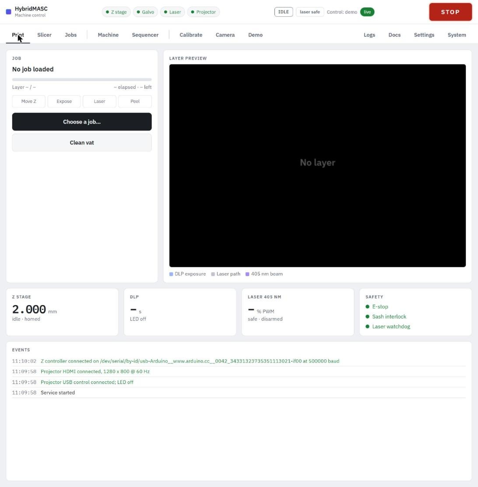

---
hide:
  - navigation
---

# HybridMASC

HybridMASC is a bottom-up DLP resin printer with a 405 nm laser added: each layer is cured by a projected image, and on layers that carry conductive features the laser then writes silver into the cured resin by reducing the silver trifluoroacetate it contains. A laptop beside the printer runs the control service and serves its web interface to browsers on the lab network.

-   :material-book-open-variant:{ .lg .middle } **User manual**

    ---

    Running the printer from its web interface: safety, start-up, homing and film zero, calibration, slicing, printing and troubleshooting.

    [:octicons-arrow-right-24: Read the manual](manual/index.md)

-   :material-alert-octagon:{ .lg .middle } **Safety first**

    ---

    The laser, the projector light, the resin and the moving plate. Read this before the first session.

    [:octicons-arrow-right-24: Safety](manual/safety.md)

-   :material-clipboard-check-outline:{ .lg .middle } **Quick reference**

    ---

    A printing session start to finish on one page, with the key numbers.

    [:octicons-arrow-right-24: Quick reference](manual/quick-reference.md)

-   :material-cog-outline:{ .lg .middle } **Design and implementation**

    ---

    How the hardware, firmware and control software are built, with bench measurements and known limitations.

    [:octicons-arrow-right-24: Design notes](design-and-implementation.md)

## The control interface

Everything runs from a browser: the printer's web interface shows its state ten times a second and has one STOP button on every page.

