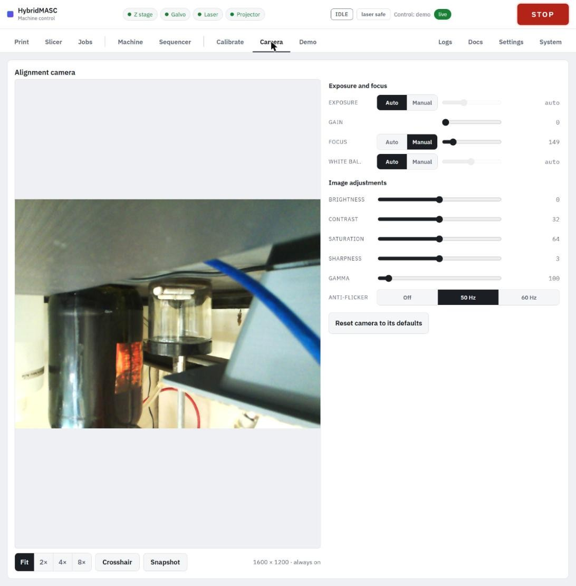
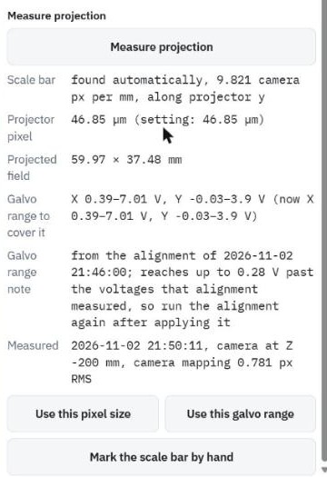
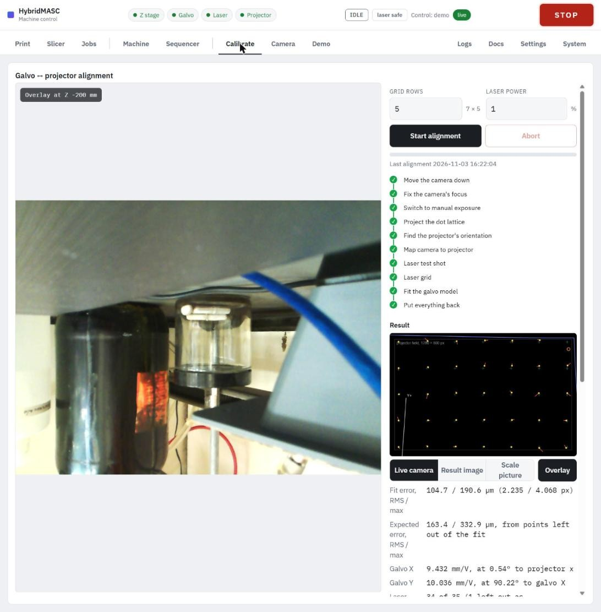

# Calibration

Calibrate in this order: camera, projection measurement, laser alignment, then an edge trace to check it. The camera's settings and the last results are saved, so this is needed only after something in the optical path has moved, not every session.

Calibration runs use no resin: so far they have been made on a tissue screen (a Kimwipe) laid where the vat film sits. The runs lower the camera to about 200 mm below the top switch, or to the film zero if that is higher. Run them with Z homed.

### Camera

The **Camera** tab shows the alignment camera live (1600 × 1200) with its controls beside it.

- **Fit**, **2×**, **4×**, **8×** zoom the view; a click zooms in on, or recentres at, that point. **Crosshair** marks the centre. **Snapshot** downloads the current frame as a JPEG.
- **Exposure**, **Focus** and **White bal.** each switch between **Auto** and **Manual**; a manual value can only be set once its switch is on Manual. **Gain** and the **Image adjustments** sliders set the rest; **Reset camera to its defaults** puts them all back.
- Keep focus on Manual: the camera's own default focus is far out.
- Settings are saved and re-applied whenever the stream starts, since the camera forgets them when unplugged. After switching to Manual, give it about 5 s to take the new value.
- The controls grey out while an alignment run is using the camera.

### Measure the projection (pixel size)

This measures the size of a projector pixel at the build plane, which the slicer uses to size parts.

1. Light the room. Lay a printed 10 mm scale bar (11 evenly spaced tick lines) on the tissue screen, in the projected field.
2. On the **Calibrate** tab, press **Measure projection**. The camera moves down, photographs the bar, and maps camera pixels to projector pixels with a projected dot lattice. Finding the bar takes about 7 s.
3. Check the result: the scale bar found, the projector pixel size, the projected field in mm, and the galvo range that covers the field.
4. Press **Use this pixel size** to make it the setting (Settings tab, slicer default). Press **Use this galvo range** to make it the galvo's allowed range.
5. If the bar isn't found, or looks wrong, press **Mark the scale bar by hand** and click its two ends on the picture.

If the note under the result says the range reaches past the voltages the last alignment measured, run the alignment again after applying it.

### Align the laser to the projector

The alignment tells the service which galvo voltages put the laser spot on each projector pixel. Every laser line in a job goes through it.

1. Put on 405 nm eyewear, switch the laser supply on, home Z and arm the laser (Machine tab).
2. On the **Calibrate** tab, set **Grid rows** (5 gives a 7 × 5 grid of laser points) and **Laser power** (1 %).
3. Press **Start alignment**. The checklist beside the view ticks through its steps: move the camera down, fix focus, switch to manual exposure, project a dot lattice, find the projector's orientation, map camera to projector, a laser test shot, the laser grid, fit the galvo model, put everything back. It takes about 2 minutes.
4. **Abort** or **STOP** ends the run.

The result lists the fit error and the expected error (from points left out of the fit), the galvo scale in mm/V and its angles, how many laser spots were used, and the camera mapping. The run on 3 November 2026 gave 104.7 µm RMS fit and 163.4 µm expected error, with 34 of 35 spots. **Live camera**, **Result image** and **Scale picture** switch the view; **Overlay** draws the run's findings over the live view, which lines up only when the camera is at the height the run measured from.

Run the alignment again after the galvo range changes, after anything in the laser, galvo or projector path is moved or bumped, and whenever the edge trace misses the outline.

### Check with an edge trace

The **Demo** tab lights a thin outline 8 px inside the projected field and runs the laser round it through the alignment. Set **Laser power** (1 %), **Rounds** (3) and **Speed** (50 mm/s), arm the laser, and press **Trace the edge**; **Abort** ends it. Watch the camera view: the spot should stay on the outline all the way round.
