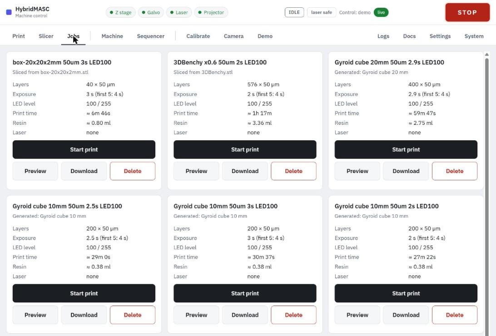

# Jobs

Every saved job has a card on the **Jobs** tab, and prints start from there.

Each card shows where the job came from and:

| Line | Meaning |
| --- | --- |
| Layers | Count × layer height |
| Exposure | Normal exposure, and the burn-in exposure for the first layers |
| LED level | The level the exposures were set at |
| Print time | Estimate with the current peel settings |
| Resin | Cured volume; a print uses a little more |
| Laser | Laser lines, or none |

The buttons:

- **Start print**: see [Printing](printing.md).
- **Preview**: plays the layers on the projector without moving anything (below).
- **Download**: the job as a .zip, named after the job.
- **Delete**: removes the job from the laptop.
- **Upload .zip** (last card): adds a job downloaded earlier.

A job .zip holds `manifest.json` (all the slice settings and estimates), the layer masks `layers/00001.png` … (1280 × 800 greyscale, white cures), and `laser.json` (the laser lines in build-plane mm).

### Preview on the projector

**Preview** opens a popup that plays the job's layers on the projector, one after another, to check the masks before committing resin. Z, the galvo and the laser stay still.

1. Empty the vat or take it out: the light cures resin, and with Z still every layer would cure in the same place.
2. Choose the pace (**0.25 s**, **0.5 s** or **1 s a layer**, or **Job's exposure times**), the **LED** level (48 by default) and the first layer.
3. Tick **The vat is empty or out**; it has to be ticked each time the popup opens.
4. Press **Start**. The popup shows a time estimate, then each layer and its number.

**Stop** or **STOP** ends it, and the LED goes off at the end. Closing the popup leaves the preview running; the card's button shows the current layer.
