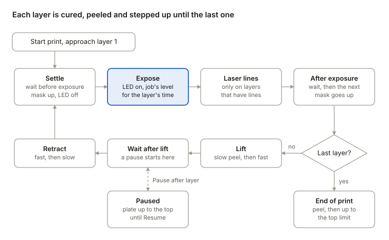
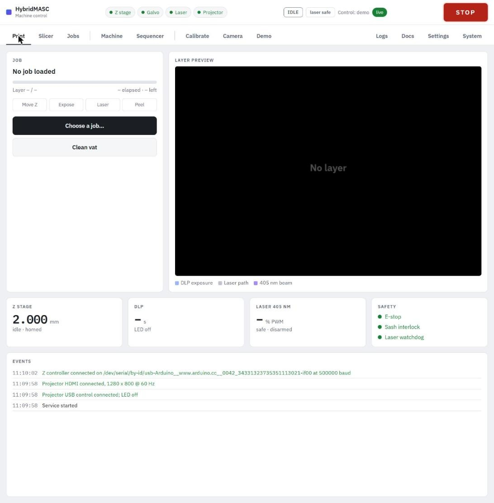

# Printing

A print runs from **Start print** on a job card and is watched, paused and stopped on the **Print** tab. Heights are measured from the film zero: layer *n* cures with the plate at *n* × the layer height.

{ .diagram }

A pause takes the plate to the top after a layer's lift; the last layer skips the lift and retract and goes straight to the end lift.

### Before you start

The service refuses to start unless Z is homed with a film zero set, the projector is connected with an HDMI signal, the job has an LED level, the part plus the lift fits under the top limit, and both lifts are more than one layer. A job with laser lines also needs the galvo, an alignment and the laser armed. Check the rest yourself:

1. The film zero belongs to this vat and film. Set it again after changing either.
2. The build plate and the vat film are clean. After a failed print, run **Clean vat** first (below).
3. The vat holds enough resin: the job card's resin figure plus a margin.
4. The peel settings on the Settings tab suit this resin. Give **Wait before exposure** at least 1 s (the default): a test print with no waits was seen pushing the film down at every layer, most likely for lack of one.
5. For a laser job: eyewear on, laser supply on, alignment current, laser armed.
6. The fume hood is running.

### Starting and watching a print

On the **Jobs** tab, press **Start print** on the job's card (**Choose a job…** on the Print tab takes you there). The plate comes down from wherever it is, at the move speed to the burn-in lift height above layer 1, then onto layer 1 as a burn-in retract.

The **Print** tab shows:

- **Job**: the job's name, a progress bar, the layer (*n* / *N*), time elapsed and left, and the current phase lit among **Move Z**, **Expose**, **Laser** and **Peel**.
- **Layer preview**: the current layer's mask (DLP exposure), its laser path, and the beam while it fires.
- **Z stage**, **DLP** and **Laser 405 nm** readouts, and the **Safety** card.
- **Events**: what the service did, newest first. The **Logs** tab keeps the full list.

### Pausing

Press **Pause after layer**. When the current layer has peeled, the plate goes on up to the top limit at the move speed and waits there, so the vat and the part can be inspected. **Resume** brings it back down to the lift height and the print carries on. Time paused isn't counted as elapsed.

### Stopping

- **Stop print** cancels the print, switches the LED and laser off, brakes Z and sends the plate up to the top, as at the end of a print. Use it to abandon a print.
- **STOP** cancels the print and stops Z at once, wherever it is, possibly in the resin or on the film. Use it when something is going wrong.

However a print ends, the LED and laser go off and the LED level goes back to what it was before.

### When the print finishes

After the last layer the plate peels slowly off the film, then rises to the top limit at the move speed. Wait for the state badge to return to IDLE before reaching in. Remove the plate with gloves on, and wash and post-cure the part as the resin requires.

### Clean vat

**Clean vat** on the Print tab cures one thin sheet over the whole film, which catches loose bits and failed layers so they can be lifted out in one piece.

1. Press **Clean vat**. Set **Cure for** (1–120 s, default 15) and the **LED** level (default 255).
2. Tick **The plate is up or off, and there's resin in the vat**.
3. Press **Start**. The plate goes up to the top limit first (Z must be homed), then the whole field shows white for the set time.
4. Peel the cured sheet off the film by hand.

**Stop** or **STOP** switches the LED off at once. This function has so far been tested only against a simulated machine.
