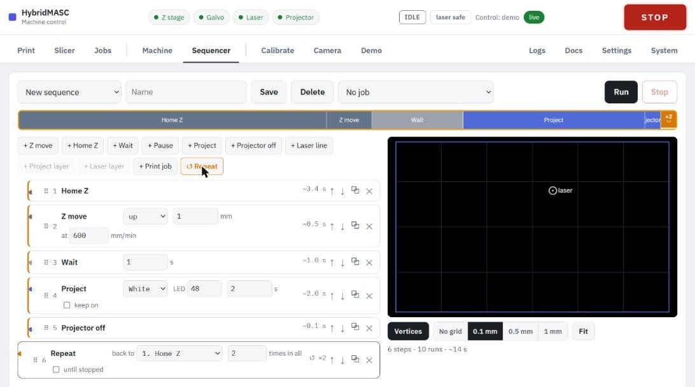

# Sequencer

The **Sequencer** builds short machine programs from steps, for tests a full print doesn't cover: exposure series, laser dose series, repeated moves, or several prints in a row.

The example above homes Z, raises the plate 1 mm, waits 1 s, shows a white field at LED level 48 for 2 s, switches the projector off, and repeats all of that twice. The strip across the top shows each step as a block as long as its estimated time.

### Steps

| Step | What it does | Set on the step |
| --- | --- | --- |
| **Z move** | Moves to a height, or up or down by a distance | To / up / down, mm, speed (6–1200 mm/min) |
| **Home Z** | Homes the stage | — |
| **Wait** | Waits | Seconds |
| **Pause** | Waits until someone presses **Continue** in a prompt shown over any tab | An optional message (up to 200 characters) |
| **Project** | Shows a test image at an LED level for a time, or keeps it on while the next steps run | Black, white, grid or focus; LED; seconds or **keep on** |
| **Projector off** | Switches the LED off | — |
| **Laser line** | Draws a line with the laser | Points (mm from the field centre), power, speed |
| **Project layer** | Shows one layer's mask from the chosen job, timed or kept on | Layer; **+1 each pass** |
| **Laser layer** | Draws one layer's laser lines from the chosen job, each at its own power and speed | Layer; **+1 each pass** |
| **Print job** | Prints a saved job exactly as **Start print** does, and waits for it to finish | The job |
| **Repeat** | Runs the steps from a chosen earlier one up to itself a number of times in all, or until stopped | Back to step, times, **until stopped** |

**Project layer** and **Laser layer** need a job chosen in the box at the top (the current slice or a saved job). With **+1 each pass**, a layer step takes the next layer each time it runs, so a Repeat can cycle through a job's layers. Repeats can nest; the page indents the steps inside and marks the band with the count.

### Building a sequence

1. Choose **New sequence** (or a saved one) and, for layer steps, a job.
2. Add steps with the **+** buttons.
3. Set each step's values on its card. Reorder with the arrows or by dragging the step's number; the copy icon duplicates a step and **×** deletes it.
4. To add a laser line by drawing, click points on the field view; double-click, press Enter or click the last point to finish it. Escape drops it. The field shows the chosen job's layer and outline, and the snap options match the Processing step.
5. Type a **Name** and press **Save** to keep it on the laptop. The sequence being edited is also kept in this browser.

### Running

Press **Run**. The service checks every step first, then shows the current step as it goes, and ends with the laser and LED off. **Stop** or **STOP** ends it. Steps that use the laser need the laser armed before Run.

During a **Print job** step, the Print tab's **Pause after layer**, **Resume** and **Stop print** work on that print. The sequence's **Stop** ends the print as Stop print does; a print that fails ends the sequence. Each print leaves the plate at the top.
