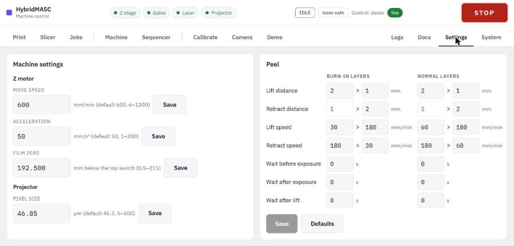

# Settings

The **Settings** tab holds the machine settings that apply to every job: each field shows its unit, default and range, and saves with its own **Save** button. The **Peel** card sets the motion of every print and saves as one profile.

### Machine settings

| Setting | Default | Range | Notes |
| --- | --- | --- | --- |
| Move speed | 600 mm/min | 6–1200 mm/min | Hand moves, the approach to layer 1, pauses and the climb at the end of a print. Warns from 900 mm/min: the unloaded stage ran clean at 1200 and lost steps at 1500. |
| Acceleration | 50 mm/s² | 1–200 mm/s² | Every Z move. Warns above 100 mm/s², the fastest tested. |
| Film zero | none | 0.5–215 mm below the top switch | See [Z stage](z-stage.md#setting-the-film-zero). Empty + **Save** clears it. |
| Pixel size | 46.2 µm | 5–500 µm | The slicer's default and the alignment's mm scale. Set from **Measure projection** (now 46.85 µm). |

### Peel profile

Each print layer lifts and retracts in two stages, written as "stage 1 > stage 2". Burn-in layers and normal layers each have their own column, laid out like Lychee's resin settings. The retract's first stage is shown, not set: it is the rest of the lift, less one layer.

| Setting | What it controls | Default, normal layers | Default, burn-in layers |
| --- | --- | --- | --- |
| Lift distance | Slow peel, then fast climb | 2 > 3 mm | 2 > 3 mm |
| Retract distance | Fast descent, then slow approach | (3) > 2 mm | (3) > 2 mm |
| Lift speed | Speeds of the two lift stages | 60 > 180 mm/min | 30 > 90 mm/min |
| Retract speed | Speeds of the two retract stages | 180 > 60 mm/min | 90 > 30 mm/min |
| Wait before exposure | Settling time, mask already up | 1 s | 1 s |
| Wait after exposure | Before the lift | 0 s | 0 s |
| Wait after lift | Before the retract | 0 s | 0 s |

On 4 November the profile was set to 2 > 1 mm lifts with all waits at 0 s; **Defaults** restores the values above. The defaults are on the cautious side of consumer resin printers'. The job cards' print times follow whatever is saved here.
