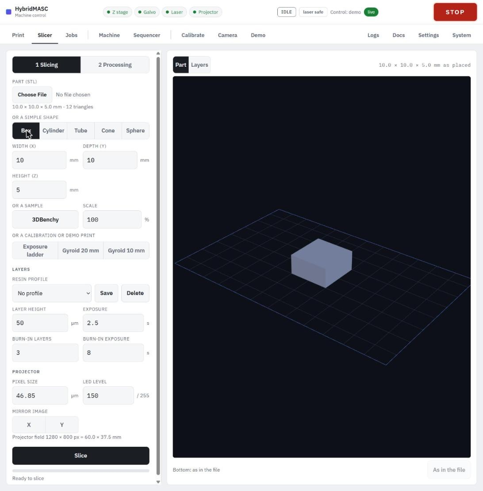
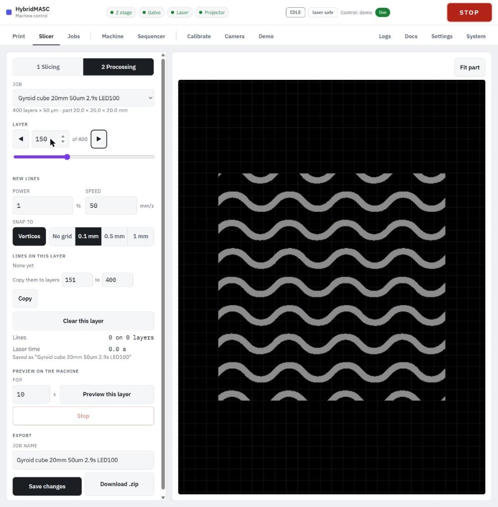

# Preparing a job

A job is made on the **Slicer** tab in two steps, switched at the top of its left panel: **1 Slicing** turns a part into layer masks, and **2 Processing** adds laser lines and exports the job. A job without laser lines can be exported straight from step 1.

### Step 1: Slicing

1. **Choose the part.** One of:
   - **Choose File**: an STL in millimetres (binary or ASCII).
   - **A simple shape**: **Box**, **Cylinder**, **Tube**, **Cone** or **Sphere**, sized in the fields that appear.
   - **3DBenchy**, the sample part, loaded at 50 % so it fits the field.
   - **A calibration or demo print**: **Exposure ladder**, **Gyroid 20 mm** or **Gyroid 10 mm** (below).
2. **Scale** the part (1–1000 %) if needed. Choosing a new part sets it back to 100 %.
3. **Orient it** in the **Part** view, which shows the build plate with the projected field to scale. Hover over a flat face to light it, and click to turn the part so that face sits on the plate. **As in the file** undoes this. A warning appears if the face is under 1 mm².
4. **Set the layers.** Pick a **Resin profile**, or fill in **Layer height** (µm), **Exposure** (s), **Burn-in layers** and **Burn-in exposure** (s). For example 50 µm, 2.5 s, 3 burn-in layers at 8 s.
5. **Set the projector.** **Pixel size** comes from the Settings tab (46.85 µm). **LED level** (16–255, default 150) is saved with the job, because the dose is level × time. **Mirror image X / Y** flips the masks only.
6. Press **Slice**. The progress bar fills, then a summary shows the layer count, estimates, resin volume and any warnings (part larger than the field, layers where the mesh isn't watertight). The **Layers** view steps through the masks.
7. **Export or go on.** Under the summary: **Job name** (filled in from the part and its settings, e.g. "3DBenchy x0.5 50um 2.5s LED150"), **Save to Jobs**, **Download .zip**, and **Next: processing**. Slices not exported are kept for a day.

**Resin profiles** keep the four layer settings and the LED level under a name, on the laptop, so every browser sees the same ones. **Save** asks for a name and confirms before replacing a different profile; the list marks a profile "(changed)" once its fields are edited.

**Calibration and demo prints** are made directly as masks, with no 3D view:

- **Exposure ladder**: eight 8 mm patches on a 1 mm base (41 × 26 × 4 mm, 80 layers at 50 µm), each given 100 % down to 30 % of the dose. Holes (0.3–1.2 mm) and slots (0.1–0.5 mm) close up when overexposed; pillars (0.2–0.8 mm) go missing when underexposed. Print it once, pick the best patch, and scale the exposure by its percentage. It assumes light is proportional to grey level, which hasn't been measured.
- **Gyroid 20 mm** and **Gyroid 10 mm**: self-supporting gyroid lattice cubes (400 and 200 layers) on a 1 mm base. At two vertical edges small pieces start unconnected and join the part some 13–15 layers later; they may cure onto the film.

### Step 2: Processing

1. Under **Job**, pick the current slice or a saved job. Step through layers with **◀** / **▶**, the layer number or the slider. **Fit part** frames the part.
2. Set **Power** (%) and **Speed** (mm/s) for new lines (1 % and 50 mm/s to start).
3. **Draw a line**: click to start it and to add each corner; click the last point again, double-click or press Enter to finish. Shift keeps a segment horizontal or vertical. **Snap to** **Vertices** (the part's corners on this layer and the points of other lines) and a **0.1 mm**, **0.5 mm** or **1 mm** grid, or **No grid**.
4. Edit each line's power and speed in **Lines on this layer**. **Copy them to layers** *a* **to** *b* → **Copy** repeats them on other layers; **Clear this layer** removes them.
5. **Preview on the machine** (optional, a dry run without resin): set **For** (1–120 s) and press **Preview this layer**. The projector shows the layer's mask at LED level 48 while the laser draws the lines over it, round and round. The laser fires, so wear eyewear; the lines are placed through the alignment. **Stop** ends it.
6. Under **Export**, name the job and press **Save to Jobs** (**Save changes** for a job already saved), or **Download .zip**.

Saving checks every line: 2–2000 points, all inside the projected field; power above 0 and at most 100 %; speed 0.1–1000 mm/s; at most 500 lines a layer.
