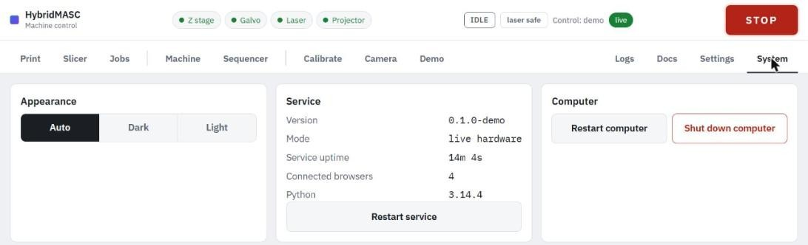

# Starting up and shutting down

Power the machine before the laptop, and the laptop before the laser. The controller sets up the galvo converters once, when it starts; it is powered from the laptop's USB, so if the galvo electronics come on after the laptop, the galvo ignores every move and the laser shows no light until the controller restarts.

### Start-up

1. Check that the fume hood is running and the build area is clear.
2. Switch on the machine's supplies (Z motor, galvo electronics, projector). Leave the laser supply off for now.
3. Switch on the laptop. The control service starts by itself about 12 s after boot; nobody needs to log in. About 40 s after boot the projector's USB control appears and the service turns its LED off.
4. Open the page. Check that all four device chips are green and that the event list shows the Z controller, the projector HDMI and the projector USB control connected.
5. Switch on the laser supply if this session needs the laser.
6. [Home Z](z-stage.md#homing). After a cold start Z is not homed, the galvo sits at 0 V (outside its allowed range) and the laser is off.

### Shutting down

1. Let the print finish, or press **Stop print**. A finished or stopped print leaves the plate at the top.
2. Switch the laser supply off.
3. On the **System** tab, press **Shut down computer**. The service switches the laser off, darkens the projector and brakes Z first; it refuses while a job runs.
4. When the laptop is off, switch off the machine's supplies.

The System tab has two other restarts:

- **Restart service** restarts only the control software. The controller keeps running, so Z stays homed and the galvo keeps its position. Use it when the page misbehaves.
- **Restart computer** reboots the laptop. Z may need homing again afterwards.

The same tab shows the service version and uptime, the number of connected browsers, the laptop's network addresses, load, temperature, memory and disk.
