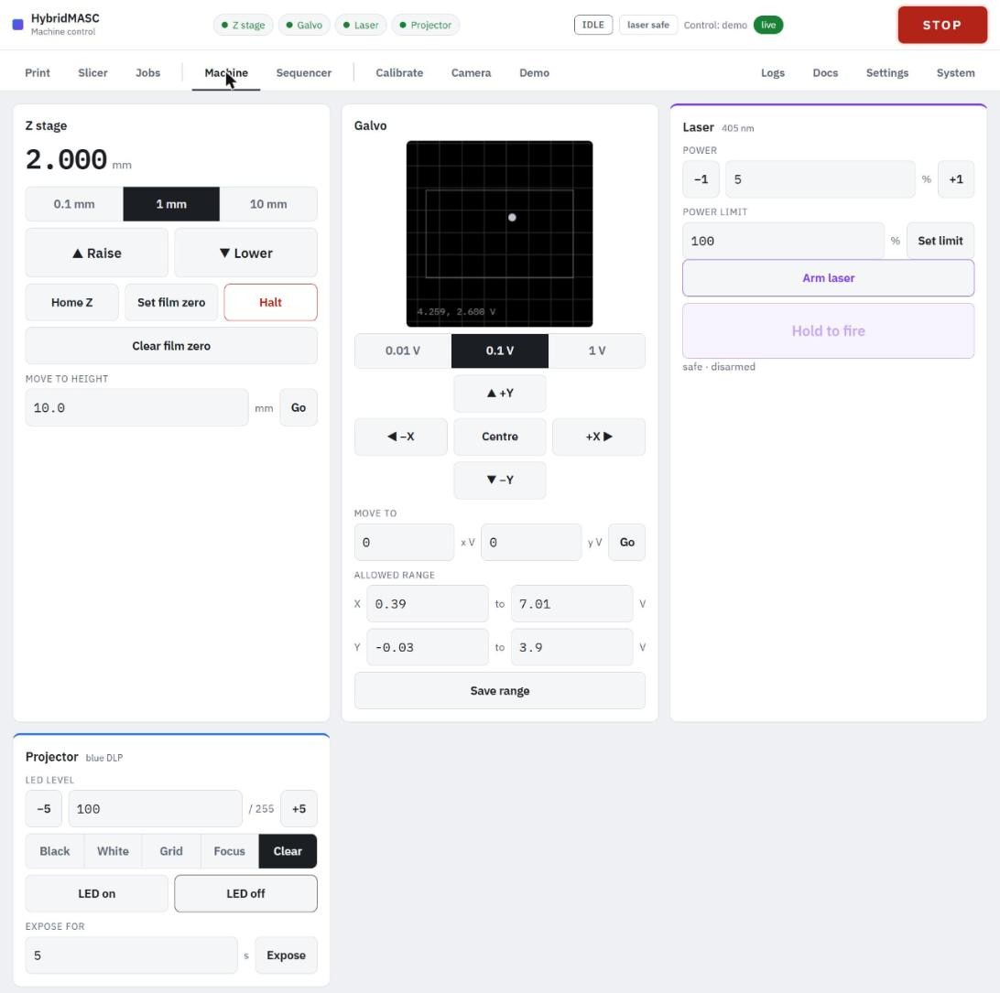

# Z stage: homing and film zero

Home Z at the start of every session, then set the film zero once for each vat: every layer height is measured from it, and it is the stage's lower limit. All hand controls for Z, the galvo, the laser and the projector are on the **Machine** tab.

### Homing

Press **Home Z**. The plate climbs at 5 mm/s until the top switch triggers, backs off 2 mm, creeps back up at 0.5 mm/s to find the switch exactly, and parks 2 mm below it. It takes a few seconds from near the top and about 45 s from the bottom of travel. Repeat homings land on the same step.

- Jog moves are refused until Z is homed.
- Homing refuses to start if the switch already reads triggered, because an unplugged sensor reads the same way.
- Each phase has a distance limit; if one runs out, homing stops and the status line says why.
- The controller loses its homing when it restarts (laptop shutdown, USB unplugged, reflash). Restarting only the service keeps it.

### Moving by hand

Pick a step (**0.1 mm**, **1 mm** or **10 mm**) and press **▲ Raise** or **▼ Lower**, or type a height under **Move to height** and press **Go**. Moves run at the move speed and acceleration on the Settings tab (600 mm/min and 50 mm/s² by default) and stay at least 0.5 mm below the top switch.

- **Halt** brakes the plate to a stop at the set acceleration.
- **STOP** stops it at once.

### Setting the film zero

The film zero is the height where the build plate meets the vat film.

!!! warning "No lower limit until it is set"
    Before a film zero exists, **Lower** and **Move to height** can drive the plate down to the frame's hard stop, through the vat. Take the first approach slowly.

1. Home Z, then fit the clean, empty vat and the clean build plate.
2. Lower the plate in **10 mm** steps until it is a few millimetres above the film, then in **1 mm** and **0.1 mm** steps.
3. Stop when the plate rests evenly on the film without pushing it down.
4. Press **Set film zero**. The Z readout now shows the height above the film, and the stage won't go below 0.
5. Raise the plate before adding resin.

The service stores the film zero as a depth below the top switch, so it survives re-homing and restarts. It is shown, and can be typed in, under **Film zero** on the Settings tab (0.5–215 mm below the switch; currently 192.500 mm). Typing a known value saves jogging down again, but the service refuses a depth above where the plate is now. **Clear film zero** removes it, and with it the lower limit.
